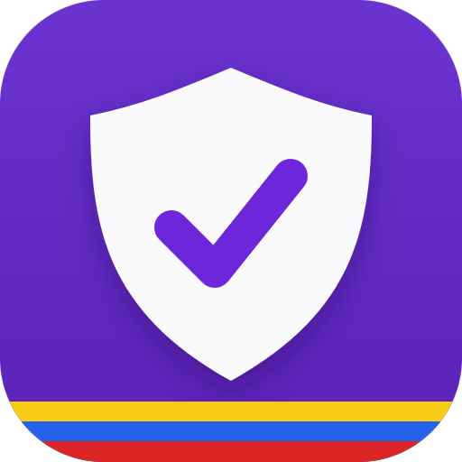
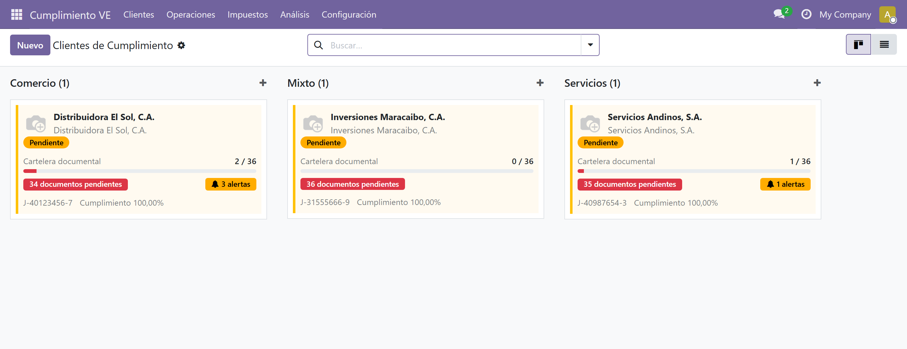

<p align="center">
  
</p>

<h1 align="center">ContaFis</h1>

<p align="center">
  <strong>Cumplimiento fiscal venezolano en Odoo 20.</strong><br/>
  Módulo para contadores y firmas que gestionan varias empresas desde una
  sola instancia.
</p>

<p align="center">
  <a href="https://github.com/MrErov/contafis-odoo/actions/workflows/ci.yml"></a>
  
  
  
</p>

<p align="center">
  <a href="docs/guia-usuario/guia-usuario.pdf"><strong>Guía de Usuario · 68 págs.</strong></a>
  &nbsp;·&nbsp;
  <a href="#instalación-rápida"><strong>Instalación rápida</strong></a>
  &nbsp;·&nbsp;
  <a href="specs/"><strong>Especificaciones</strong></a>
</p>

---

ContaFis es un módulo **Odoo 20.0** para la gestión fiscal, parafiscal y
documental de empresas venezolanas. Centraliza clientes, vencimientos,
cartelera documental, alertas, libro de compras/ventas, planilla IVA 99030 y
conciliación ISLR.

<p align="center">
  
</p>

## Contexto

ContaFis está pensado para contadores que administran varios clientes.
Centraliza vencimientos, documentos, libros y alertas por empresa para reducir
la consolidación manual entre hojas de cálculo, correos y carpetas.

---

## Características principales

| | |
|---|---|
| **Calendario SENIAT e ISLR**<br/>Vencimientos SENIAT por RIF, tablas ISLR, feriados bancarios y corrimiento a día hábil. | **Conciliación ISLR**<br/>Importación desde Excel, recálculo y reporte PDF. |
| **Multiempresa**<br/>Aislamiento de clientes, obligaciones y conciliaciones por compañía y contador. | **Alertas**<br/>Email y WhatsApp vía `wa.me`. |
| **Bandeja y análisis**<br/>Vencimientos, acciones masivas, KPIs, gráfico y pivote. | **Importadores Excel**<br/>Libro de compras/ventas, cartelera y planilla IVA 99030. |
| **Factura Física Rápida**<br/>Carga de compras desde talonario o máquina fiscal. | **Reportes PDF**<br/>Cumplimiento y planilla IVA. |

---

## Capturas

| Bandeja de vencimientos | Análisis de obligaciones |
|:---:|:---:|
|  |  |

| Cartelera fiscal documental |
|:---:|
|  |

| Calendario SENIAT | Factura Física Rápida |
|:---:|:---:|
|  |  |

> Estas son 6 capturas destacadas. La guía incluye 39 capturas del flujo
> completo: alta de clientes, facturas, libro, planilla IVA, retenciones,
> calendario, cartelera y alertas.

---

## Documentación

- **[Guía de Usuario (PDF · 68 páginas)](docs/guia-usuario/guia-usuario.pdf)** —
  recorrido paso a paso con capturas, preguntas frecuentes, glosario y
  limitaciones.
- **[Especificaciones por capacidad](docs/capacidades/)** — una spec
  autocontenida por módulo funcional.
- **[Historial SDD](specs/)** — `spec.md`, `plan.md` y `tasks.md` de cada
  iteración, desde el backend hasta la conciliación ISLR.
- **[CHANGELOG](CHANGELOG.md)** — evolución y fixes por fase.
- **[Limitaciones conocidas](docs/guia-usuario/anexo-limitaciones.md)** —
  alcance actual y pendientes.

---

## Stack tecnológico

| Capa | Tecnología |
|---|---|
| ERP | **Odoo 20.0 Community** |
| Base de datos | **PostgreSQL 15** |
| Runtime | **Python 3.10+** |
| Infraestructura | **Docker + Docker Compose** |
| Testing E2E | **Playwright** (9 escenarios de navegador) |
| CI/CD | **GitHub Actions** (lint + backend + E2E) |
| Metodología | **Spec-Driven Development (SDD)** |

El desarrollo se guía por especificaciones versionadas (`specs/`), un contrato
de agentes (`AGENTS.md`) y pruebas como criterio de cierre. Cada capacidad se
planifica, implementa y cierra con la suite y el CI en verde.

---

## Instalación rápida

Requisitos: Docker Desktop y Docker Compose.

```bash
git clone https://github.com/MrErov/contafis-odoo.git
cd contafis-odoo

mkdir -p config/odoo.conf
cp odoo.conf.example config/odoo.conf/odoo.conf
# Edita config/odoo.conf/odoo.conf y cambia admin_passwd y db_password

docker compose up -d

docker compose run --rm web odoo -d contea \
  -i l10n_ve_compliance_manager --stop-after-init --workers 0
```

Abre **http://localhost:8090** en el navegador. Para actualizar el módulo tras
un `git pull`:

```bash
docker compose run --rm web odoo -d contea \
  -u l10n_ve_compliance_manager --stop-after-init --workers 0
```

---

## Verificación

**340 tests pasando:** 331 backend (`TransactionCase`) + 9 E2E (Playwright).

```bash
# Backend
docker compose run --rm web odoo -d contea \
  -u l10n_ve_compliance_manager \
  --test-enable --stop-after-init --workers 0 \
  --test-tags /l10n_ve_compliance_manager

# E2E (con Odoo corriendo en http://localhost:8090)
npm install
npm run test:e2e
```

La suite cubre calendario SENIAT, tablas ISLR, generación idempotente,
seguridad por contador, multiempresa, retenciones, libro de compras/ventas,
planilla IVA, conciliación ISLR y su PDF.

---

## Roadmap

- [x] Backend, calendario SENIAT, alertas, bandeja, retenciones y cartelera.
- [x] Libro de compras/ventas, planilla IVA 99030 e importadores Excel.
- [x] Bandeja de vencimientos, KPIs y aislamiento multiempresa.
- [x] Conciliación ISLR con importador Excel y reporte PDF.
- [ ] Portal del cliente (solo lectura).
- [ ] Integración opcional con WhatsApp Business API.

---

## Autor

**Eurick Ospino** — Desarrollador

[GitHub @MrErov](https://github.com/MrErov) ·
[LinkedIn](https://www.linkedin.com/in/eurick-ospino-18a75a134/) ·
[eurickramiro.ospinovelasquez@gmail.com](mailto:eurickramiro.ospinovelasquez@gmail.com)

Contribuciones bienvenidas: abre un issue o revisa
[CONTRIBUTING.md](CONTRIBUTING.md). Reportes de seguridad:
[SECURITY.md](SECURITY.md).

---

## Licencia

**LGPL-3.0** — consulta [LICENSE](LICENSE).
