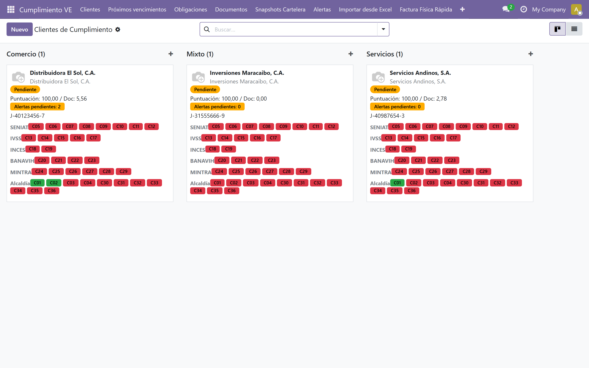
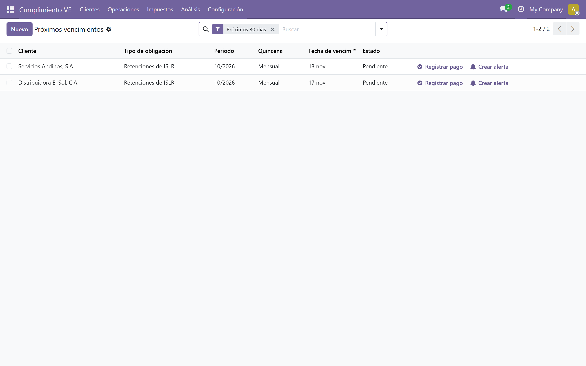
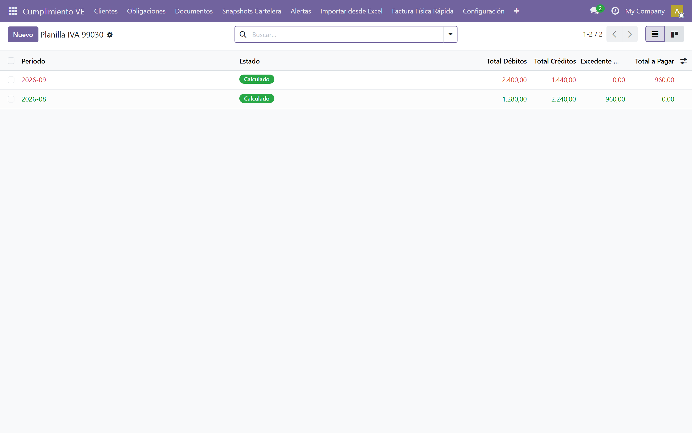
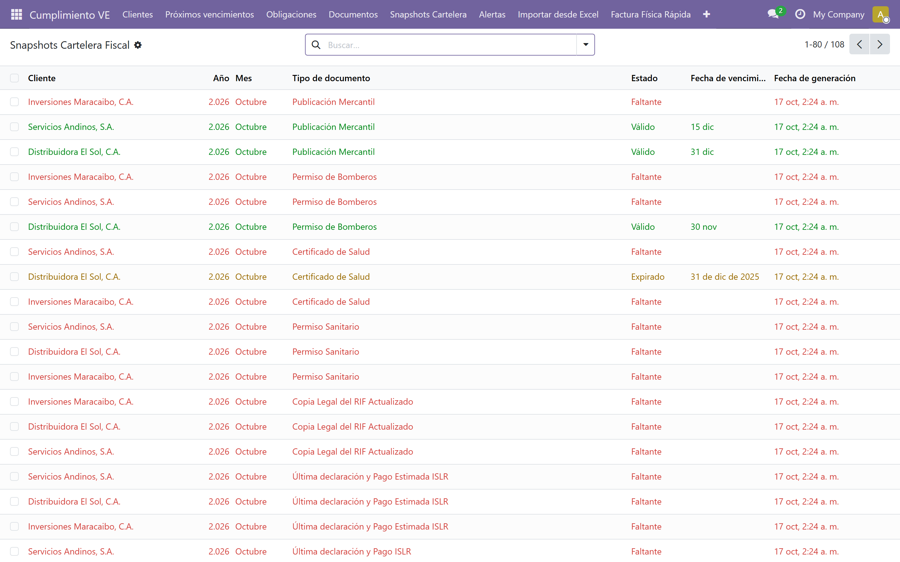
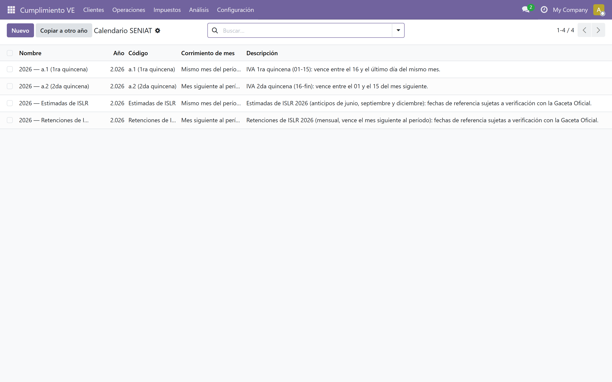

<p align="center">
  
</p>

# l10n_ve_compliance_manager


Módulo **Odoo 19.0** para la gestión integral del cumplimiento fiscal,
parafiscal y documental de empresas y negocios en **Venezuela**, diseñado
para contadores y firmas contables que gestionan múltiples clientes.



---

## 🎯 Propósito

Permite a un contador monitorear todas las obligaciones fiscales,
parafiscales y municipales de sus clientes, alertar automáticamente
sobre vencimientos y documentos por expirar, y generar reportes de
cumplimiento listos para presentar al cliente.

El módulo centraliza el seguimiento de:

- **SENIAT:** IVA, ISLR, IGTF, retenciones de IVA e ISLR.
- **Parafiscales:** IVSS, INCES, BANAVIH, Paro Forzoso.
- **Municipales:** IAE, licencias de actividades económicas.
- **Cartelera fiscal documental:** RIF, solvencia laboral, certificado
  INCES, permiso de bomberos, y más.

---

## ✨ Funcionalidades

- **Multi-cliente:** un contador gestiona N empresas desde una sola
  instancia de Odoo.
- **Calendario SENIAT 2026:** cálculo automático de vencimientos según el
  último dígito del RIF, conforme a la Providencia Administrativa
  N° SNAT/2025/000091 (Gaceta Oficial N° 43.283). Tablas a.1/a.2 (IVA
  quincenal, Sujeto Pasivo Especial) precargadas y editables.
- **Tablas de ISLR 2026:** estimadas de ISLR (jun/sep/dic) y retenciones
  de ISLR (mensual, vence el mes siguiente) por último dígito del RIF,
  asignables a cualquier cliente (sin gate SPE) y marcadas como
  referencia sujeta a verificación con la Gaceta Oficial.
- **Feriados bancarios y corrimiento:** 13 feriados nacionales 2026
  editables; los vencimientos que caen en fin de semana o feriado se
  corren al siguiente día hábil.
- **Generación automática:** cron mensual con ventana rodante (mes actual
  + próximo) e idempotente; botón "Generar obligaciones" por cliente y
  alerta `calendar_missing` si falta la tabla del año.
- **Wizard "Copiar a otro año":** duplica las tablas del calendario
  (a.1/a.2/est_islr/ret_islr) hacia un año nuevo.
- **Reglas parafiscales:** "primeros 5 días hábiles" para IVSS, BANAVIH
  y Paro Forzoso; periodicidad trimestral para INCES.
- **Cartelera fiscal:** control de vigencia de documentos obligatorios
  con alertas de renovación configurables.
- **Alertas automáticas:** email vía `mail.template` y WhatsApp vía
  `wa.me` (sin costo de API), con escalado al contador del cliente.
- **Dashboard del contador:** estado de cumplimiento por cliente con
  puntuación de 0 a 100.
- **Retenciones:** vinculadas a facturas de proveedor (`in_invoice`) y
  publicadas en `account.move`.
- **Reportes PDF:** estado de cumplimiento exportable por cliente.
- **Seguridad por grupos y por contador:** `account.group_account_user`
  (lectura), `account.group_account_manager` (CRUD), grupo propio
  `l10n_ve_compliance_accountant` y record rules que aíslan los datos
  de cada cliente según `accountant_id`.

---

## 📸 Capturas

| Próximos vencimientos (30 días) | Libro de compras y ventas |
|---|---|
|  |  |

| Planilla de IVA (Forma 99030) | Cartelera fiscal documental |
|---|---|
|  |  |

| Calendario SENIAT 2026 | Alertas de cumplimiento |
|---|---|
|  |  |

---

## 📦 Modelos

| Modelo | Descripción |
|---|---|
| `l10n.ve.compliance.client` | Cliente del contador (empresa o negocio) |
| `l10n.ve.institution` | SENIAT, IVSS, INCES, BANAVIH, municipios |
| `l10n.ve.obligation.type` | Catálogo maestro de obligaciones |
| `l10n.ve.obligation` | Obligación concreta por cliente y período |
| `l10n.ve.document.type` | Catálogo de tipos de documento |
| `l10n.ve.document` | Documento con vigencia, adjunto y estado |
| `l10n.ve.alert` | Alertas generadas por el cron |
| `l10n.retention` | Retenciones vinculadas a `account.move` |
| `l10n.ve.seniat.calendar.table` | Tabla SENIAT por año y código: a.1/a.2/est_islr/ret_islr (2026 precargada) |
| `l10n.ve.seniat.calendar` | Día de vencimiento por mes y último dígito del RIF |
| `l10n.ve.bank.holiday` | Feriados bancarios (base del corrimiento a día hábil) |
| `l10n.ve.copy.calendar.wizard` | Wizard "Copiar calendario a otro año" |
| **Extensiones** | `account.move`, `res.partner` |

---

## 🚀 Instalación

### Requisitos

- Odoo 19.0 Community
- PostgreSQL 14+
- Docker + Docker Compose (recomendado)

### Pasos

```bash
# 1. Clonar el repositorio
git clone https://github.com/MrErov/contafis-odoo-19.0v.git
cd contafis-odoo-19.0v

# 2. Copiar la configuración de ejemplo
cp odoo.conf.example odoo.conf
# Edita odoo.conf y ajusta admin_passwd y db_password

# 3. Levantar los contenedores
docker compose up -d

# 4. Instalar el módulo
docker compose run --rm web odoo -d contea \
  -i l10n_ve_compliance_manager --stop-after-init --workers 0

# 5. Abrir en el navegador
# http://localhost:8090
```

Alternativamente, si usas una instalación local de Odoo, copia la carpeta
`addons/l10n_ve_compliance_manager` en tu `addons_path` y reinicia Odoo.

---

## 🧪 Tests

**222 pruebas backend** (`TransactionCase`) + **7 pruebas E2E** (Playwright)
= **229 pruebas** pasando sobre Odoo 19.0 + PostgreSQL vía Docker.

Cobertura backend:

- Tablas SENIAT 2026 (a.1/a.2/est_islr/ret_islr), feriados bancarios y
  corrimiento a día hábil.
- Cálculo de vencimientos por último dígito del RIF: quincenas SPE
  (a.1/a.2), día 15 no-SPE, estimadas ISLR jun/sep/dic y retenciones
  ISLR mensuales.
- Generación automática idempotente (ventana rodante), alerta
  `calendar_missing` y flujo de alertas reutilizado.
- Reglas de seguridad por contador y bandeja "Próximos vencimientos".
- Wizard "Copiar a otro año" (duplica tablas y líneas).
- Alertas del cron (`due_soon`, `overdue`, `missing_payment`) y
  `compliance_score` (rango 0–100).
- Retenciones en facturas `in_invoice`, cartelera documental y libro de
  compras/ventas (import/export Excel, planilla IVA 99030).

Ejecutar backend:

```bash
docker compose run --rm web odoo -d contea \
  -u l10n_ve_compliance_manager \
  --test-enable --stop-after-init --workers 0 \
  --test-tags /l10n_ve_compliance_manager:standard
```

Ejecutar E2E (requiere Odoo levantado en `http://localhost:8090`):

```bash
npm install
npm run test:e2e
```

---

## 🗂️ Estructura del proyecto

```
contafis-odoo-19.0v/
├── AGENTS.md
├── SPEC.md
├── CHANGELOG.md
├── CONTRIBUTING.md
├── LICENSE
├── README.md
├── docker-compose.yml
├── odoo.conf.example
├── opencode.json
├── .opencode/
│   └── skills/
│       └── calcular-retencion-venezuela/
├── docs/
│   ├── capacidades/
│   │   ├── 01-calendario-seniat.md
│   │   ├── 02-gestion-alertas.md
│   │   ├── 03-cartelera-fiscal.md
│   │   ├── 04-retenciones.md
│   │   ├── 05-dashboard-reportes.md
│   │   ├── 06-importacion-excel.md
│   │   ├── 07-cartelera-excel.md
│   │   ├── 08-evidencias.md
│   │   ├── 09-libro-compras-ventas.md
│   │   └── 10-importacion-libro-compras-ventas.md
│   └── guia-usuario/          # fuente + PDF de la guía (58 págs.)
├── specs/                     # SDD: 001-backend-odoo-first … 004-tablas-islr
├── tests/
│   └── e2e/                   # Playwright (smoke, wizard, regenerar libro)
└── addons/
    └── l10n_ve_compliance_manager/
        ├── __manifest__.py
        ├── models/
        ├── views/
        ├── wizards/
        ├── data/
        ├── demo/
        ├── security/
        ├── report/
        └── tests/
```

---

## 🧠 Metodología: Spec-Driven Development

Este proyecto aplica **SDD (Spec-Driven Development)** asistido por
agentes IA:

- `SPEC.md` → índice de capacidades.
- `docs/capacidades/*.md` → una spec autocontenida por capacidad.
- `AGENTS.md` → manual de operaciones para el agente IA.
- `opencode.json` → configuración del subagente `odoo19-dev`.
- `.opencode/skills/` → skills reutilizables específicos del dominio.

---

## 🛠️ Herramientas y metodología

- **Odoo 19.0 Community** (LTS hasta 2028)
- **Python 3.10+**
- **PostgreSQL 14+**
- **Docker / Docker Compose**
- **OpenCode** (agente IA)
- **Spec-Driven Development (SDD)**

---

## 📸 Capturas

La guía de usuario incluye capturas reales del flujo completo (dashboard,
obligaciones, calendario SENIAT, alertas, wizard de factura física y
reportes): ver [`docs/guia-usuario/guia-usuario.pdf`](docs/guia-usuario/).

---

## 🗺️ Roadmap

- ☑ Fases 1-7: módulo base (modelos, vistas, cron, alertas, dashboard,
  retenciones y primeras pruebas unitarias)
- ☑ Spec 001: backend Odoo-first (wizard factura física, sync
  `account.move` → libro de compras/ventas)
- ☑ Fase H: E2E Playwright + CI en GitHub Actions (lint + backend + e2e)
- ☑ Fase I: guía de usuario (portada, TOC, capturas reales, PDF 58 págs.)
- ☑ Spec 002: integración MCP de Odoo para OpenCode Desktop
- ☑ Spec 003: calendario SENIAT 2026 (tablas a.1/a.2, feriados,
  corrimiento a día hábil, generación automática, seguridad por contador,
  bandeja de vencimientos y wizard de copia)
- ☑ Spec 004: tablas de ISLR 2026 (estimadas jun/sep/dic y retenciones
  mensuales, sin gate SPE)
- □ Spec 11: conciliación ISLR (montos y tasas de retención)
- □ E2E Fases 5-6: planilla IVA y multi-company
- □ Portal del cliente (solo lectura)
- □ Integración opcional con WhatsApp Business API

---

## 🤝 Contribuciones

Las contribuciones son bienvenidas. Para cambios importantes, por favor
abre primero un *issue* para discutir qué te gustaría cambiar.

Ver [CONTRIBUTING.md](CONTRIBUTING.md) para más detalles.

---

## 👤 Autor

**Eurick Ospino** — Contador y desarrollador Odoo

- GitHub: [@MrErov](https://github.com/MrErov)
- LinkedIn: [eurick-ospino](https://www.linkedin.com/in/eurick-ospino-18a75a134/)
- Email: eurickramiro.ospinovelasquez@gmail.com

---

## 📄 Licencia

Este proyecto está bajo la licencia **LGPL-3.0**. Consulta el archivo
[LICENSE](LICENSE) para más detalles.
