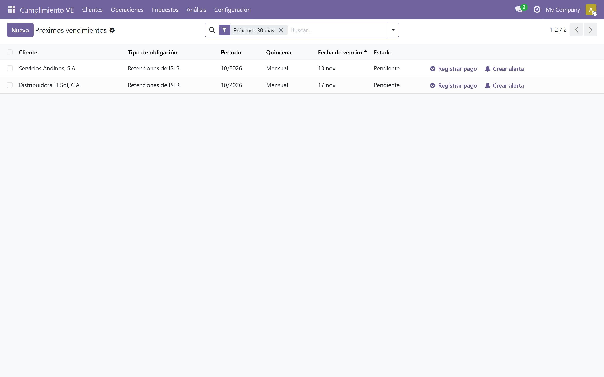

<p align="center">
  
</p>

<h1 align="center">ContaFis</h1>

<p align="center">
  <strong>Cumplimiento fiscal venezolano, orquestado.</strong><br/>
  El centro de comando que contadores y firmas contables usan para gestionar
  todas las obligaciones de sus clientes desde una sola instancia de Odoo.
</p>

<p align="center">
  <a href="https://github.com/MrErov/contafis-odoo-19.0v/actions/workflows/ci.yml"></a>
  
  
  
  
  
  
</p>

<p align="center">
  <a href="docs/guia-usuario/guia-usuario.pdf"><strong>📘 Guía de Usuario · 68 págs.</strong></a>
  &nbsp;·&nbsp;
  <a href="#-instalación-rápida"><strong>🚀 Instalación rápida</strong></a>
  &nbsp;·&nbsp;
  <a href="specs/"><strong>🧩 Especificaciones</strong></a>
</p>

---

ContaFis es un módulo **Odoo 19.0** para la gestión integral del cumplimiento
fiscal, parafiscal y documental en **Venezuela**. Reemplaza la maraña de hojas
de cálculo, recordatorios y carpetas compartidas por un único lugar donde el
contador ve —y resuelve— el estado de cada empresa: SENIAT, IVSS, INCES,
BANAVIH, municipios y documentos obligatorios.

| 340 | 68 | Multi-company | 3/3 |
|:---:|:---:|:---:|:---:|
| tests automatizados | páginas de guía | clientes aislados por compañía | jobs de CI en verde |

---

## ✨ Características principales

| | |
|---|---|
| **📅 Calendario SENIAT (IVA/ISLR)**<br/>Vencimientos calculados por el último dígito del RIF, tablas a.1/a.2 para IVA quincenal, estimadas y retenciones de ISLR, feriados bancarios y corrimiento automático a día hábil. Generación mensual idempotente y wizard para copiar el calendario a otro año. | **🧮 Conciliación ISLR (Excel → PDF)**<br/>Importa la hoja «Conciliación Fiscal» del Excel del cliente, recalcula mercancía disponible, costo de venta, renta bruta, deducciones y utilidad neta; advierte descuadres y el exceso del tope del 10% en sueldos directivos, y genera un PDF validado para el expediente. |
| **🏢 Multi-company real**<br/>Un contador, N empresas. Reglas de registro y grupos de seguridad aíslan clientes, obligaciones y conciliaciones por compañía y por contador asignado. | **🔔 Alertas que llegan**<br/>Avisos de vencimiento próximo, atrasado y pago faltante por email y WhatsApp (`wa.me`), con escalado automático al contador responsable. |
| **📊 Dashboard y análisis**<br/>Puntuación de cumplimiento de 0 a 100 por cliente, bandeja de vencimientos accionable, KPIs con vistas gráficas y pivote, y reportes PDF listos para el cliente. | **📥 Importadores Excel**<br/>Libro de compras y ventas, cartelera fiscal y planilla IVA 99030 (Forma 99030 SENIAT) con importación, validación y exportación bidireccional. |

> **Recién cerrado · Spec 011:** la conciliación ISLR ya está implementada:
> 8 pruebas nuevas de ciclo de vida, importación del fixture real y reporte PDF
> adjunto al validar.

---

## 📸 Capturas

| Panel multi-cliente con semáforo fiscal | Bandeja de vencimientos accionable |
|:---:|:---:|
|  |  |

| Cartelera fiscal documental |
|:---:|
|  |

> La guía incluye 39 capturas reales del flujo completo: alta de
> clientes, facturas, libro, planilla IVA, retenciones, calendario, cartelera
> y alertas.

---

## 📚 Documentación

- **[Guía de Usuario (PDF · 68 páginas)](docs/guia-usuario/guia-usuario.pdf)** —
  recorrido paso a paso con capturas, preguntas frecuentes, glosario y
  limitaciones.
- **[Especificaciones por capacidad](docs/capacidades/)** — una spec
  autocontenida por módulo funcional.
- **[Historial SDD](specs/)** — `spec.md`, `plan.md` y `tasks.md` de cada
  iteración, desde el backend hasta la conciliación ISLR.
- **[CHANGELOG](CHANGELOG.md)** — evolución y fixes por fase.

---

## 🛠️ Stack tecnológico

| Capa | Tecnología |
|---|---|
| ERP | **Odoo 19.0 Community** |
| Base de datos | **PostgreSQL 15** |
| Runtime | **Python 3.10+** |
| Infraestructura | **Docker + Docker Compose** |
| Testing E2E | **Playwright** (9 escenarios de navegador) |
| CI/CD | **GitHub Actions** (lint + backend + E2E) |
| Metodología | **Spec-Driven Development (SDD) con IA** |

El desarrollo se guía por especificaciones versionadas (`specs/`), un contrato
de agentes (`AGENTS.md`), skills de dominio y pruebas como criterio de cierre.
Cada capacidad nace como spec, se planifica, se implementa y solo se cierra
cuando la suite completa y el CI están en verde.

---

## 🚀 Instalación rápida

Requisitos: Docker Desktop y Docker Compose.

```bash
git clone https://github.com/MrErov/contafis-odoo-19.0v.git
cd contafis-odoo-19.0v

mkdir -p config/odoo.conf
cp odoo.conf.example config/odoo.conf/odoo.conf
# Edita config/odoo.conf/odoo.conf y cambia admin_passwd y db_password

docker compose up -d

docker compose run --rm web odoo -d contea \
  -i l10n_ve_compliance_manager --stop-after-init --workers 0
```

Abre **http://localhost:8090** y listo. Para actualizar el módulo tras un
`git pull`:

```bash
docker compose run --rm web odoo -d contea \
  -u l10n_ve_compliance_manager --stop-after-init --workers 0
```

---

## 🧪 Verificación

**340 tests pasando:** 331 backend (`TransactionCase`) + 9 E2E (Playwright).

```bash
# Backend
docker compose run --rm web odoo -d contea \
  -u l10n_ve_compliance_manager \
  --test-enable --stop-after-init --workers 0 \
  --test-tags /l10n_ve_compliance_manager

# E2E (con Odoo corriendo en http://localhost:8090)
npm install
npm run test:e2e
```

La suite cubre calendario SENIAT, tablas ISLR, generación idempotente,
seguridad por contador, multi-compañía, retenciones, libro de compras/ventas,
planilla IVA, conciliación ISLR y su PDF.

---

## 🗺️ Roadmap

- ☑ Backend, calendario SENIAT, alertas, dashboard, retenciones y cartelera.
- ☑ Libro de compras/ventas, planilla IVA 99030 e importadores Excel.
- ☑ Bandeja accionable, KPIs y aislamiento multi-compañía.
- ☑ Conciliación ISLR con importador Excel y reporte PDF (Spec 011).
- ☐ Portal del cliente (solo lectura).
- ☐ Integración opcional con WhatsApp Business API.

---

## 👤 Autor

**Eurick Ospino** — Contador y desarrollador Odoo

[GitHub @MrErov](https://github.com/MrErov) ·
[LinkedIn](https://www.linkedin.com/in/eurick-ospino-18a75a134/) ·
[eurickramiro.ospinovelasquez@gmail.com](mailto:eurickramiro.ospinovelasquez@gmail.com)

Contribuciones bienvenidas: abre un issue o revisa
[CONTRIBUTING.md](CONTRIBUTING.md). Reportes de seguridad:
[SECURITY.md](SECURITY.md).

---

## 📄 Licencia

**LGPL-3.0** — consulta [LICENSE](LICENSE).
