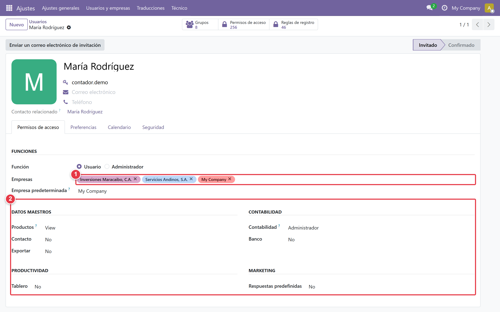
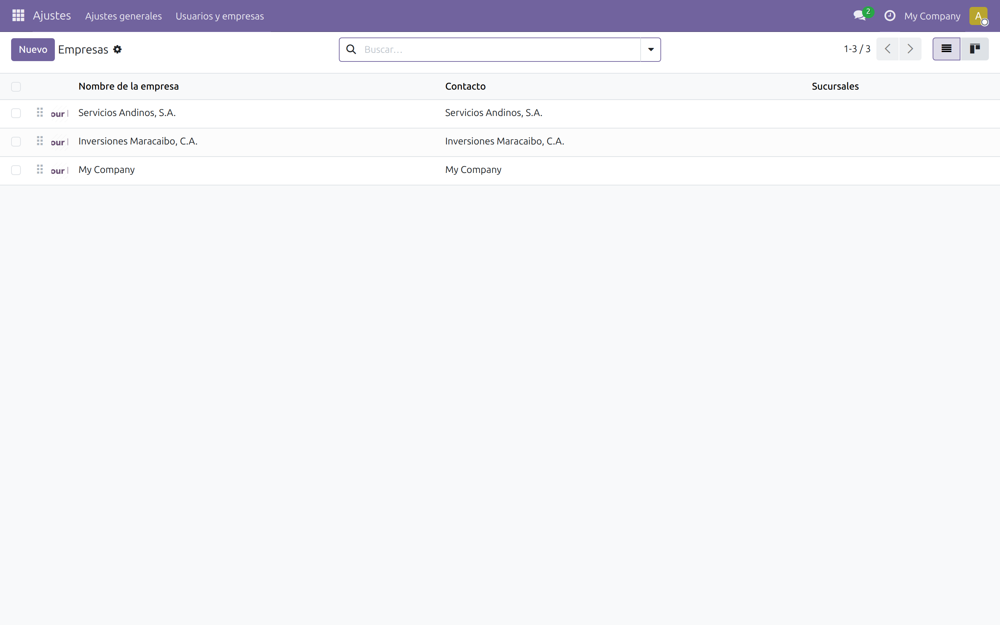

# Primeros pasos

## Antes de empezar

Antes de iniciar sesión, tenga a mano la siguiente información:

- URL de acceso a su instancia de Odoo
- Usuario y contraseña de administrador
- RIF de la empresa (formato J-XXXXXXXX-X)
- Razón social exacta como aparece en el RIF
- Dirección fiscal completa
- Alícuota de IVA que aplica (16% general, 8% reducida, o ambas)

Si es una instalación nueva, los datos vienen configurados por defecto. Si es una instalación existente, el administrador del sistema debe proveer estas credenciales antes de continuar.

## 1. Iniciar sesión

Abra su navegador e ingrese la URL de su instancia de Odoo. El formato
típico es `http://<servidor>:8069`.

En una instalación nueva, las credenciales por defecto son:

- **Usuario:** `admin`
- **Contraseña:** `admin`

La primera vez que inicie sesión, el sistema le pedirá cambiar la
contraseña. Este paso es obligatorio por seguridad.

Si olvidó su contraseña, contacte al administrador del sistema. No es posible recuperarla desde la interfaz de Odoo.

## 2. Configurar la empresa

Ruta: *Ajustes → Usuarios y empresas → Empresas*

Seleccione la compañía principal y complete los siguientes campos:

- **RIF:** ingrese el valor en el campo **VAT** con formato J-XXXXXXXX-X
- **Razón Social:** ingrese el nombre exacto como aparece en el RIF
- **Dirección fiscal:** complete Estado, Municipio, Ciudad y Calle
- **País:** verifique que esté seleccionado **Venezuela**
- **Moneda:** verifique que esté seleccionada **VES** (Bolívar)

El RIF debe ser válido según el algoritmo de módulo 11. Odoo lo valida al guardar. Si aparece el mensaje "RIF inválido", revise el último dígito del documento.

## 3. Configurar el usuario del contador

Ruta: *Ajustes → Usuarios y empresas → Usuarios → (seleccionar usuario)*

En la pestaña **Preferencias**, configure:

- **Idioma:** Español (VE)
- **Zona horaria:** (GMT-4) Caracas
- **Firma de correo:** agregue su nombre y RIF

En la pestaña **Permisos de acceso** se define qué puede hacer el usuario y sobre qué empresas:

- **Función:** deje **Usuario**. La opción *Administrador* da acceso a toda la configuración del sistema y no es necesaria para un contador.
- **Empresas:** agregue una etiqueta por cada cliente que atenderá ese contador (incluya aquí toda empresa nueva que cree en el punto 4). Sin empresas asignadas, el usuario no verá datos de ningún cliente.
- **Empresa predeterminada:** la empresa con la que abre sesión; el contador puede cambiarla luego desde la barra superior.
- **Derechos de acceso:** marque **Contador de Cumplimiento VE** (uso completo del módulo) y, si va a trabajar con el *Libro de Compras y Ventas* y las *Planillas de IVA*, el rol **Contabilidad → Administrador**.

Un contador solo verá los clientes que tenga asignados en el campo **Contador** del cliente (sección 03), además de las empresas marcadas aquí. El administrador ve todo.

## 4. Crear una empresa por cliente

Ruta: *Ajustes → Usuarios y empresas → Empresas → [Nuevo]*

En este sistema, **cada cliente que usted atiende se registra como una empresa (compañía) de Odoo**. Esa separación hace que las obligaciones, documentos y alertas de cada cliente queden aislados de los demás.

Repita el proceso por cada cliente:

1. Pulse **[Nuevo]** y escriba la **razón social** exacta del cliente.
2. Complete el RIF (campo **VAT**) y la dirección fiscal si los tiene.
3. Guarde y repita para el siguiente cliente.

Solo el **administrador** puede crear empresas (Función *Administrador* en los permisos del usuario, punto 3). Si usted es contador, pida al administrador que cree la empresa y la agregue a su lista **Empresas**; una empresa que no esté en esa lista es invisible para usted.

Su propia firma ya quedó como empresa en el punto 2; las empresas de los clientes son adicionales y no se mezclan entre sí. Al dar de alta un cliente nuevo, recuerde también agregar su empresa a la lista **Empresas** del contador que lo atenderá (punto 3). En la sección 03 aprenderá a activar una o varias empresas a la vez para trabajar con todos los clientes desde la misma pantalla.

## 5. Verificar que el módulo esté instalado

Ruta: *Aplicaciones → buscar "l10n_ve_compliance_manager"*

En la lista de resultados:

- Si aparece con estado **Instalado** → está listo para usar
- Si aparece con estado **Para instalar** → haga clic en [Instalar]
- Si no aparece → contacte al administrador (el módulo debe estar
  en el addons path del servidor)

## 6. Configurar correo saliente (para alertas)

Ruta: *Ajustes → Técnico → Correo saliente*

Complete los datos del servidor SMTP de su proveedor de correo:

- **Servidor SMTP**
- **Puerto**
- **Usuario**
- **Contraseña**

Haga clic en [Probar conexión] para verificar que la configuración
sea correcta.

Este paso es requisito para recibir las alertas por correo electrónico de la sección 10.

## Siguiente paso

Una vez configurada la empresa y el usuario, el siguiente paso
es registrar sus clientes. Continúa con [Gestión de clientes](./03-gestion-clientes.md).
