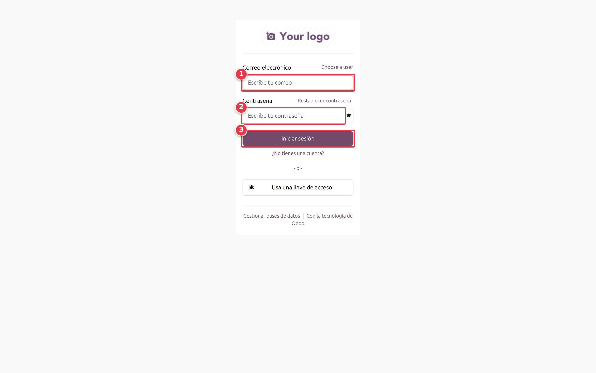
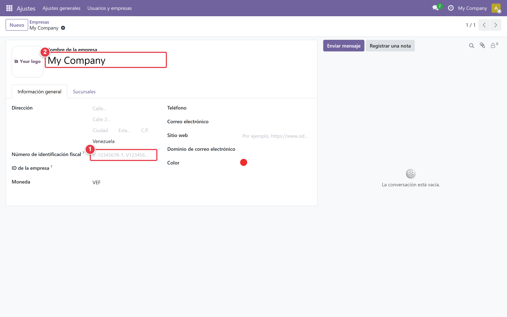
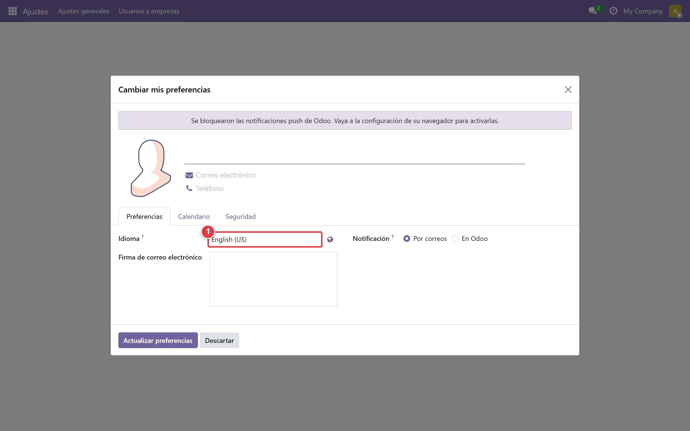
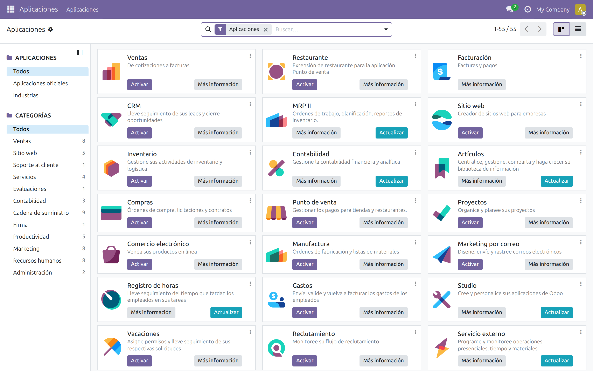
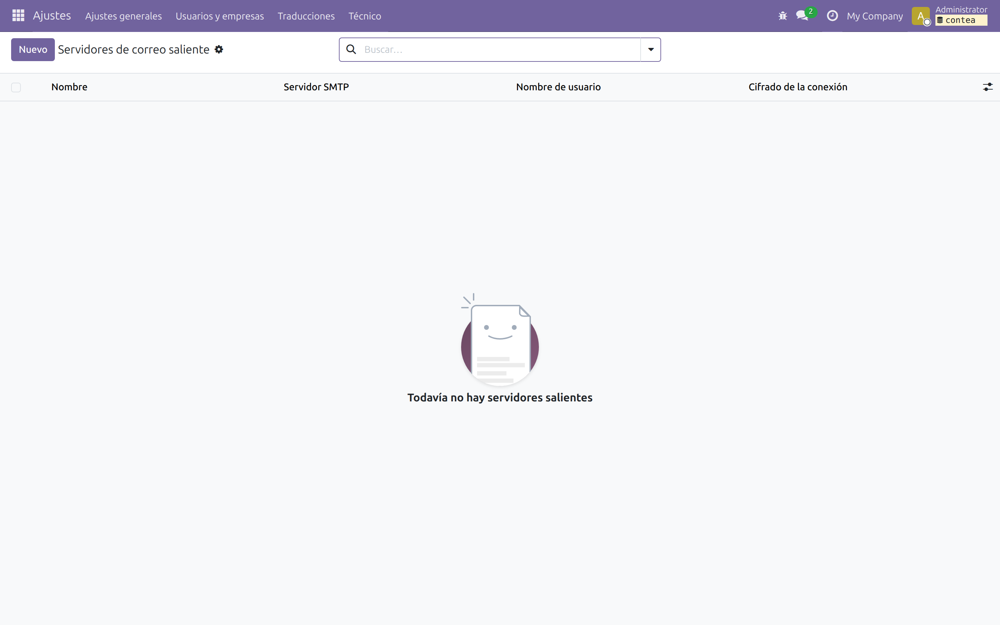

# Primeros pasos

## Antes de empezar

Antes de iniciar sesión, tenga a mano la siguiente información:

- URL de acceso a su instancia de Odoo
- Usuario y contraseña de administrador
- RIF de la empresa (formato J-XXXXXXXX-X)
- Razón social exacta como aparece en el RIF
- Dirección fiscal completa
- Alícuota de IVA que aplica (16% general, 8% reducida, o ambas)

Si es una instalación nueva, los datos vienen configurados por defecto. Si es una instalación existente, el administrador del sistema debe proveer estas credenciales antes de continuar.

## 1. Iniciar sesión

Abra su navegador e ingrese la URL de su instancia de Odoo. El formato
típico es `http://<servidor>:8069`.

En una instalación nueva, las credenciales por defecto son:

- **Usuario:** `admin`
- **Contraseña:** `admin`

La primera vez que inicie sesión, el sistema le pedirá cambiar la
contraseña. Este paso es obligatorio por seguridad.

Si olvidó su contraseña, contacte al administrador del sistema. No es posible recuperarla desde la interfaz de Odoo.

## 2. Configurar la empresa

Ruta: *Ajustes → Usuarios y Compañías → Compañías*

Seleccione la compañía principal y complete los siguientes campos:

- **RIF:** ingrese el valor en el campo **VAT** con formato J-XXXXXXXX-X
- **Razón Social:** ingrese el nombre exacto como aparece en el RIF
- **Dirección fiscal:** complete Estado, Municipio, Ciudad y Calle
- **País:** verifique que esté seleccionado **Venezuela**
- **Moneda:** verifique que esté seleccionada **VES** (Bolívar)

El RIF debe ser válido según el algoritmo de módulo 11. Odoo lo valida al guardar. Si aparece el mensaje "RIF inválido", revise el último dígito del documento.

## 3. Configurar el usuario del contador

Ruta: *Ajustes → Usuarios y Compañías → Usuarios → (seleccionar usuario)*

En la pestaña de preferencias, configure:

- **Idioma:** Español (VE)
- **Zona horaria:** (GMT-4) Caracas
- **Firma de correo:** agregue su nombre y RIF

Si maneja múltiples clientes, active la opción **Multi-compañías**
en la pestaña de Accesos. Esto le permitirá cambiar entre empresas
sin cerrar sesión.

## 4. Verificar que el módulo esté instalado

Ruta: *Aplicaciones → buscar "l10n_ve_compliance_manager"*

En la lista de resultados:

- Si aparece con estado **Instalado** → está listo para usar
- Si aparece con estado **Para instalar** → haga clic en [Instalar]
- Si no aparece → contacte al administrador (el módulo debe estar
  en el addons path del servidor)

<!-- VERIFICAR: ruta real en Odoo 19 para búsqueda de aplicaciones -->

## 5. Configurar correo saliente (para alertas)

Ruta: *Ajustes → Técnico → Correo saliente*

Complete los datos del servidor SMTP de su proveedor de correo:

- **Servidor SMTP**
- **Puerto**
- **Usuario**
- **Contraseña**

Haga clic en [Probar conexión] para verificar que la configuración
sea correcta.

Este paso es requisito para recibir las alertas por correo electrónico de la sección 10.

<!-- VERIFICAR: ruta real en Odoo 19 para configuración SMTP -->

## Siguiente paso

Una vez configurada la empresa y el usuario, el siguiente paso
es registrar sus clientes. Continúa con [Gestión de clientes](./03-gestion-clientes.md).
