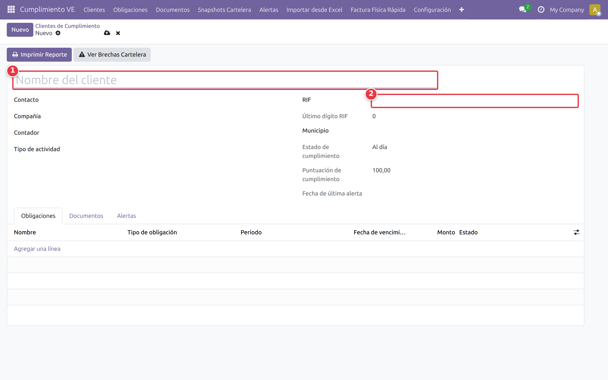
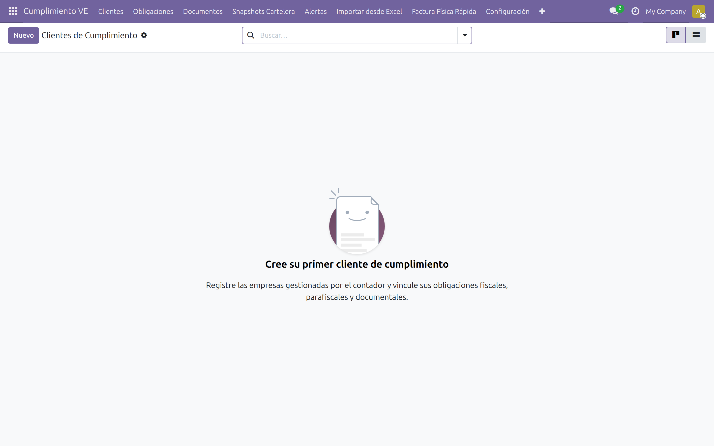

# Gestión de clientes

## ¿Qué es un "cliente de cumplimiento"?

En este sistema, un **cliente de cumplimiento** es la empresa cuyo RIF usted administra como contador. Es distinto del *partner comercial* (contacto de Odoo base): el cliente de cumplimiento vincula ese partner con obligaciones fiscales, documentos y alertas. En el escenario del piloto, un contador gestiona 7 o más clientes desde la misma instancia.

## Crear un cliente nuevo

Ruta: *Cumplimiento VE → Clientes → [Nuevo]*

Complete los campos del formulario:

- **Nombre:** nombre comercial del cliente (ej. *Distribuidora Los Andes, C.A.*)
- **Contacto:** seleccione el partner existente o cree uno nuevo
- **Compañía:** seleccione la compañía de Odoo asociada
- **Contador:** usuario responsable (opcional)
- **RIF:** ingrese el valor con formato J-XXXXXXXX-X
- **Tipo de actividad:** Comercio, Servicios, Industria o Mixto
- **Municipio:** municipio de la dirección fiscal

Los campos **Estado de cumplimiento**, **Puntuación de cumplimiento** y **Última alerta** se calculan automáticamente y no se editan manualmente.

## Validación del RIF

El RIF debe ser válido según el algoritmo de módulo 11. Si ingresa un RIF inválido, el sistema muestra un error al guardar. Para verificar, revise el último dígito del documento:

- Correcto: `J-31527189-4`
- Incorrecto: `J-12345678-0`

El campo **Último dígito RIF** se calcula automáticamente a partir del valor ingresado.

## Lista de clientes

Ruta: *Cumplimiento VE → Clientes*

La lista muestra las columnas: **Nombre**, **RIF**, **Último dígito**, **Contacto**, **Compañía**, **Tipo de actividad**, **Municipio**, **Estado de cumplimiento** y **Puntuación**.

Puede filtrar por **RIF**, **Nombre**, **Contacto**, **Contador**, **Tipo de actividad** o **Municipio** usando el campo de búsqueda.

## Vista kanban

Ruta: *Cumplimiento VE → Clientes → [icono Kanban]*

Cada tarjeta muestra: logo del partner, nombre del cliente, RIF, estado de cumplimiento (badge de color), puntuación, alertas pendientes y mini-cartelera del mes actual. Las tarjetas se agrupan por **Tipo de actividad** por defecto.

## Editar un cliente

Haga clic en el cliente desde la lista o el kanban. Modifique los campos necesarios y presione [Guardar].

## Archivar un cliente

Archivar oculta el cliente sin eliminar sus datos. Borrar elimina el registro permanentemente. Se recomienda **archivar** clientes que dejan de estar activos.

Para archivar: abra el cliente → menú [Acción] → [Archivar].

## Cambiar entre clientes (multi-cliente)

En la barra superior, el selector de compañía permite cambiar entre las empresas configuradas. Las facturas, libros y planillas se filtran por la compañía activa. Para ver datos de un cliente específico, use los filtros de búsqueda o el kanban.

## Siguiente paso

> Con los clientes registrados, el siguiente paso es cargar sus facturas físicas. Continúa con [Cargar facturas físicas](./04-cargar-facturas.md).
