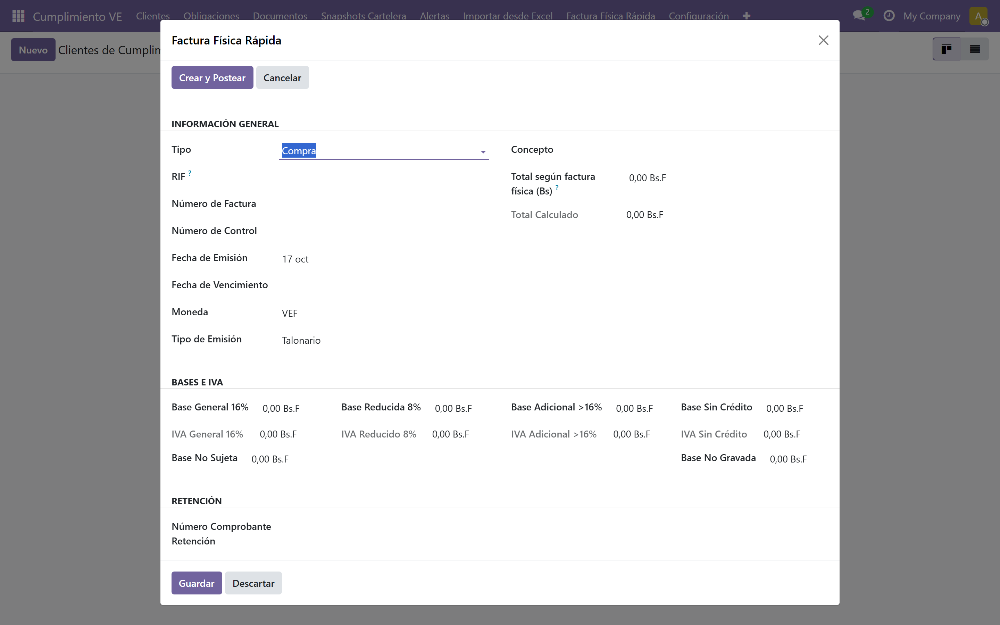
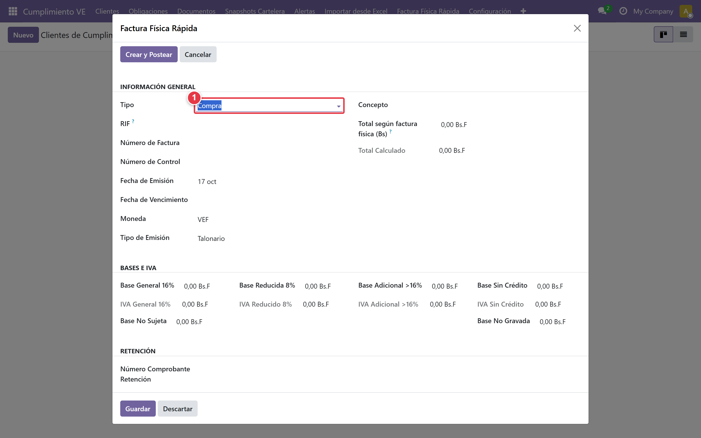
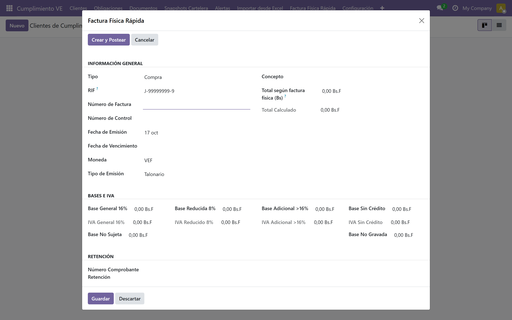
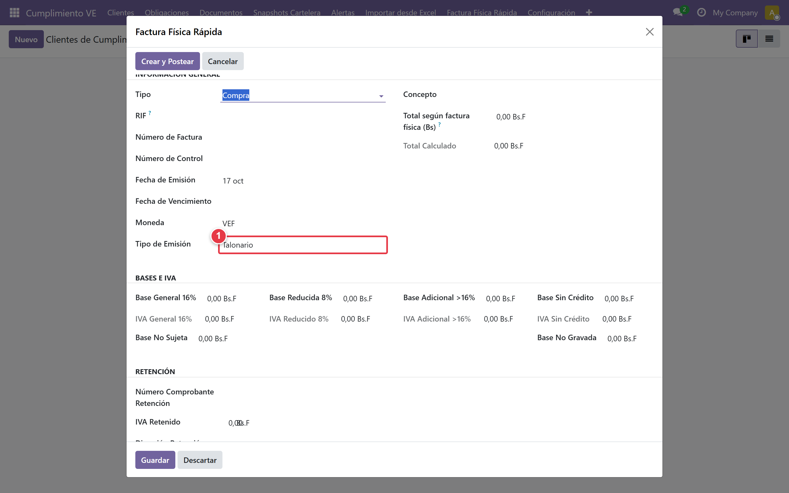
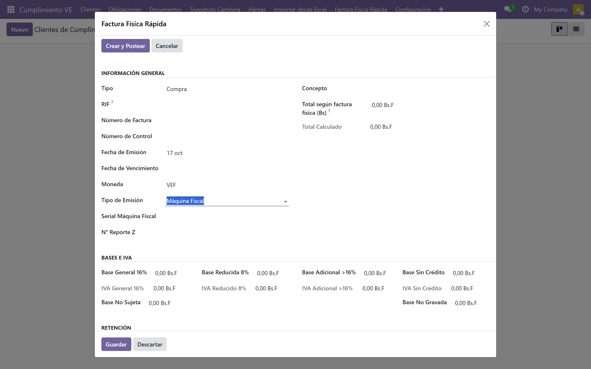

# Cargar facturas físicas

## ¿Qué son las facturas físicas?

El contador recibe facturas en papel, foto o PDF. En Venezuela hay 3 formatos: talonario, máquina fiscal y digital. El wizard las digitaliza sin re-tipear todos los datos.

## Los 3 tipos de emisión

### Talonario

Facturas pre-impresas. Datos mínimos: número de factura, número de control y monto base.

### Máquina fiscal

Requiere serial de máquina y número de reporte Z.

Los 3 datos (serial + reporte Z + número de factura) son **obligatorios** para SENIAT.

### Digital

Facturas PDF. Sin serial ni reporte Z.

## Cómo abrir el wizard

Ruta: *Cumplimiento VE → Factura Física Rápida*

Se abre un modal con el formulario completo.

## Completar el formulario

### 1. Seleccionar tipo (Compra o Venta)

- **Compra:** factura de proveedor (in_invoice)
- **Venta:** factura a cliente (out_invoice)

### 2. RIF del proveedor o cliente

Ingrese el RIF con formato J-XXXXXXXX-X. El sistema valida el dígito de control (módulo 11).

- Si el partner existe → muestra la razón social automáticamente
- Si no existe → se expande la sección **Nuevo Partner**

Complete los datos del nuevo partner: razón social, tipo (Empresa o Persona), dirección, email y teléfono.

### 3. Tipo de emisión

Seleccione **Talonario**, **Máquina Fiscal** o **Digital**.

### 4. Datos de la factura

- **Número de Factura:** obligatorio
- **Número de Control:** obligatorio
- **Fecha de Emisión:** obligatoria
- **Fecha de Vencimiento:** opcional
- **Moneda:** por defecto VES

### 5. Campos según emisión

Si selecciona **Máquina Fiscal**, aparecen dos campos adicionales:

- **Serial Máquina Fiscal**
- **N° Reporte Z**

### 6. Bases e IVA

Ingrese los montos según la alícuota que aplique:

- **Base General 16%** → IVA 16% (calculado)
- **Base Reducida 8%** → IVA 8% (calculado)
- **Base Adicional >16%** → IVA 16% (calculado)
- **Base Sin Crédito** → IVA 16% (calculado)
- **Base No Sujeta** → sin IVA
- **Base No Gravada** → sin IVA

El **Total Calculado** se actualiza automáticamente.

### 7. Retención (solo compras)

Si el tipo es **Compra**, aparece la sección de retención:

- **Número Comprobante Retención**
- **IVA Retenido**
- **Dirección Retención:** Retenido por comprador, Retenido a vendedor o Retenido a terceros

## Guardar la factura

Al hacer clic en [Crear y Postear] el sistema realiza todo el trabajo por usted:

1. Se crea un `account.move` (in_invoice o out_invoice)
2. Se postea automáticamente
3. Se registra en el libro correspondiente
4. Se actualiza el total para la Planilla 99030
5. Se abre la factura creada

## Casos especiales

### Factura sin RIF del proveedor

Si el proveedor no tiene RIF válido, no es posible cargar la factura. Solicite al proveedor un RIF válido o verifique el documento.

### Corrección de una factura cargada por error

Si cargó una factura con datos incorrectos, abra la factura creada, revierta el asiento (botón [Revertir]) y vuelva a cargar los datos correctos.

## Consejos prácticos

- Cargue las facturas a medida que llegan, no acumule para fin de mes
- Verifique el libro de Compras/Ventas semanalmente
- Guarde los archivos físicos o digitales como respaldo
- Revise que el número de control coincida con el documento original

## Siguiente paso

> Con las facturas cargadas, el siguiente paso es revisar el Libro de Compras y Ventas. Continúa con [Libro de Compras y Ventas](./05-libro-compras-ventas.md).
