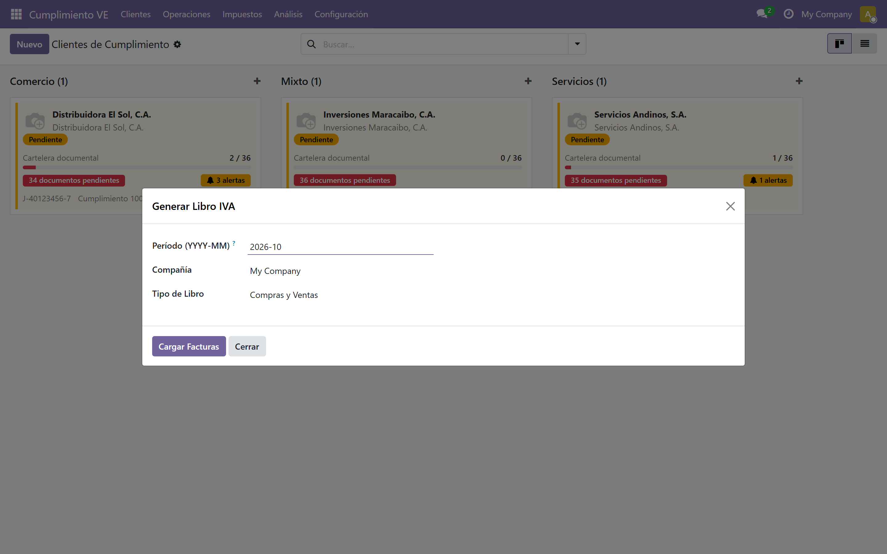
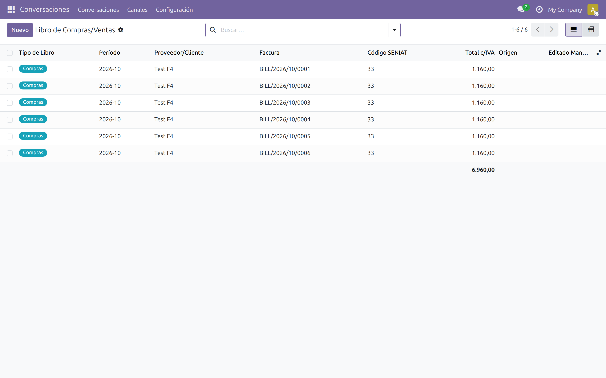
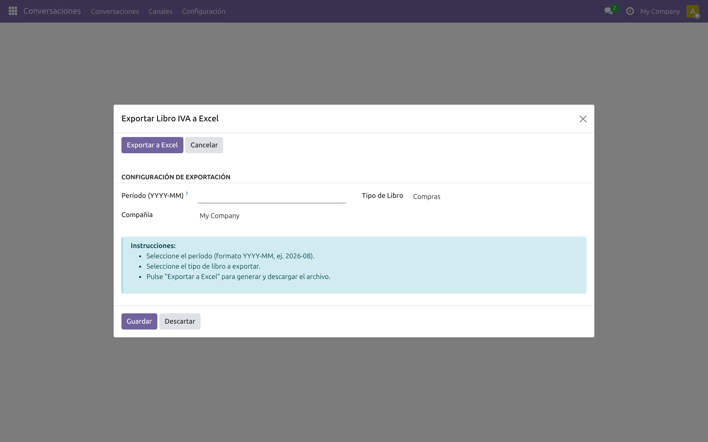

# Libro de Compras y Ventas

## ¿Qué es el libro?

El libro es el registro mensual de todas las operaciones. Es obligatorio para SENIAT. Se genera automáticamente desde las facturas cargadas en el sistema.

## Generar el libro del mes

Ruta: *Cumplimiento VE → Generar Libro IVA*

Complete los campos del wizard:

- **Período:** formato YYYY-MM (ej. `2026-08`)
- **Compañía:** seleccione la empresa
- **Tipo de Libro:** Solo Compras, Solo Ventas o Compras y Ventas

Presione [Cargar Facturas] para detectar las facturas del período. Luego presione [Generar Libro] para crear las líneas.

## Ver las líneas del libro

Ruta: *Cumplimiento VE → Libro de Compras/Ventas*

La lista muestra las columnas: **Tipo de Libro**, **Período**, **Proveedor/Cliente**, **Factura**, **Código SENIAT**, **Total c/IVA**, **N° Control**, **Base 16%**, **IVA 16%**, **Base 8%**, **IVA 8%**, **Base s/Crédito**, **Base No Sujeta**, **Base No Gravada**, **N° Retención**, **IVA Retenido** y **Dir. Retención**.

Puede agrupar por **Tipo de Libro**, **Período**, **Proveedor/Cliente** o **Código SENIAT**.

## Filtrar por cliente y período

Use los filtros predefinidos:

- **Compras** o **Ventas**
- **Con Retención**
- **Con Importación**

Para filtrar por cliente, use el campo de búsqueda por **Proveedor/Cliente** o **Factura**.

## Importar desde Excel

Ruta: *Cumplimiento VE → Importar → Libro desde Excel*

Seleccione el archivo Excel con el formato esperado. El sistema valida las columnas y muestra errores antes de importar.

El archivo debe tener el formato de columnas exacto que espera el sistema. Descargue la plantilla de ejemplo antes de importar.

## Exportar el libro

Ruta: *Cumplimiento VE → Libro de Compras/Ventas → [Acción] → Exportar Libro IVA a Excel*

Opciones de exportación:

- **Período:** formato YYYY-MM
- **Compañía:** seleccione la empresa
- **Tipo de Libro:** Compras, Ventas o Compras y Ventas

Presione [Exportar a Excel] para generar y descargar el archivo.

## Regenerar el libro

Si se modifica una factura después de generar el libro, debe regenerar para reflejar los cambios. Abra una línea del libro y presione [Regenerar libro] en el menú de acciones.

## Siguiente paso

> Con el libro del mes listo, el siguiente paso es generar la Planilla IVA 99030. Continúa con [Planilla IVA 99030](./06-planilla-iva-99030.md).
