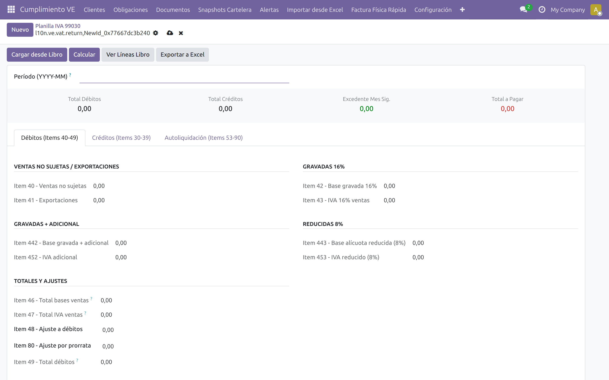
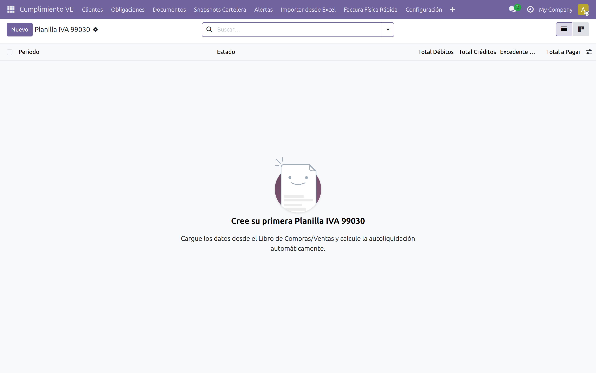

# Planilla IVA 99030

## ¿Qué es la Planilla 99030?

La Planilla 99030 es la declaración mensual de IVA en Venezuela. Contiene 48 ítems predefinidos por SENIAT. Se llena con los totales del libro de compras/ventas del mes.

## Generar la planilla del mes

Ruta: *Cumplimiento VE → Planilla IVA 99030 → [Nuevo]*

Complete los campos:

- **Período:** formato YYYY-MM (ej. `2026-08`)
- **Compañía:** seleccione la empresa

Presione [Guardar] para crear la planilla en estado Borrador.

## Ver los ítems calculados

Ruta: *Cumplimiento VE → Planilla IVA 99030*

Abra la planilla y presione [Cargar desde Libro] para importar los totales del libro. Luego presione [Calcular] para calcular los agregados automáticos.

La vista muestra 3 pestañas:

- **Débitos (Items 40-49):** ventas gravadas, IVA ventas, ajustes
- **Créditos (Items 30-39):** compras, IVA compras, créditos fiscales
- **Autoliquidación (Items 53-90):** IVA a pagar, excedente, retenciones

## Exportar la planilla

Ruta: botón [Exportar a Excel] en la planilla

El sistema genera un archivo Excel con los 48 ítems en el formato de la Forma 99030 SENIAT.

## Ítems editables manualmente

La mayoría de los ítems son calculados automáticamente desde el libro. Los ítems editables manualmente incluyen:

- **Item 48:** Ajuste a los débitos fiscales de períodos anteriores
- **Item 80:** Ajuste por prorrata
- **Item 37:** Créditos fiscales producto del porcentaje de prorrata
- **Item 38:** Ajuste a los créditos fiscales de períodos anteriores
- **Item 21:** Reintegro solicitado (solo exportadores)
- **Item 81:** Reintegro solicitado (entes exonerados)
- **Item 82:** Certificados de débitos fiscales exonerados
- **Item 51:** Retenciones descontadas en declaración sustituida
- **Item 54:** Retenciones acumuladas por descontar
- **Item 73:** Recuperación de retenciones solicitado
- **Item 75-77:** Percepciones
- **Item 90:** Observaciones

## Validar antes de enviar

Checklist antes de presentar la declaración:

- Verificar que los totales coincidan con el libro de compras/ventas
- Revisar los ítems editables manualmente
- Comparar con el borrador de la declaración en el portal SENIAT
- Verificar que el período y la compañía sean correctos

## Siguiente paso

> Con la planilla lista, el siguiente paso es registrar las retenciones del mes. Continúa con [Retenciones](./07-retenciones.md).
