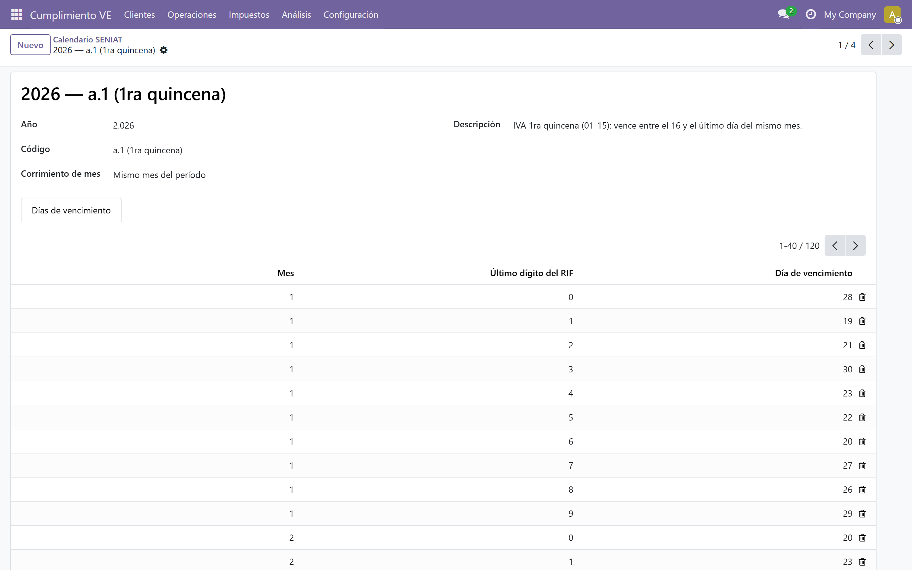
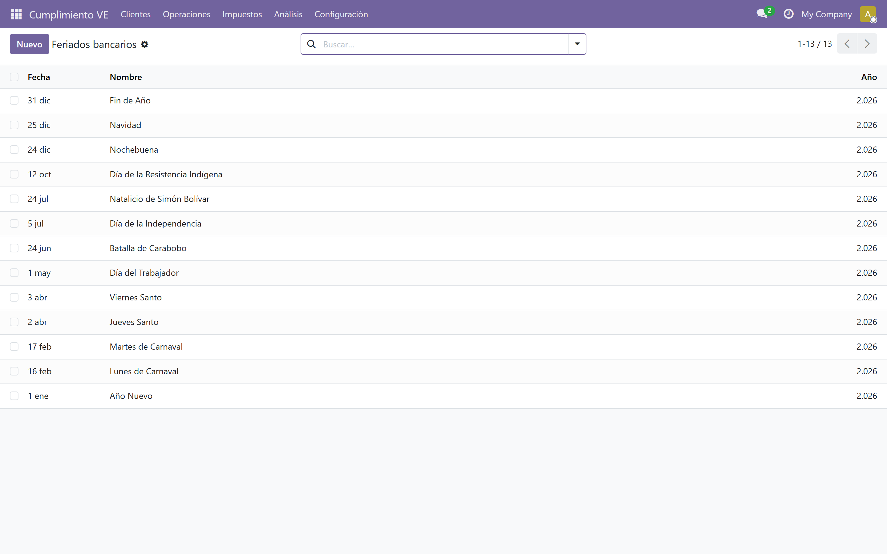
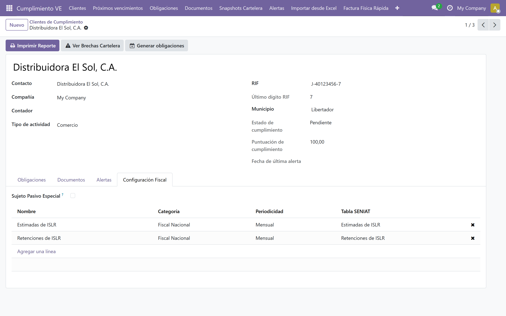

# Calendario SENIAT e ISLR

## ¿Qué es el calendario SENIAT?

En Venezuela, el SENIAT publica cada año un calendario de vencimientos por obligación (IVA, ISLR, IGTF). Las fechas se asignan según el **último dígito del RIF** del contribuyente. El módulo incluye ese calendario 2026 como datos editables y calcula la fecha de vencimiento de cada obligación automáticamente.

Referencia normativa vigente:

- **Providencia SNAT/2025/000091** — Gaceta Oficial N° 43.283 del 23 de diciembre de 2025.

El calendario se administra como **tablas editables**, no como código. Si la providencia cambia una fecha, se corrige en pantalla y el módulo no pisa la corrección en las próximas actualizaciones.

## Tablas del calendario

Ruta: *Cumplimiento VE → Configuración → Calendario SENIAT*

El módulo precarga cuatro tablas para 2026:

- **2026 — a.1 (1ra quincena):** sujetos pasivos especiales (SPE) quincenales; vence en el mismo mes del período.
- **2026 — a.2 (2da quincena):** SPE quincenales; vence el mes siguiente al período.
- **2026 — Estimadas de ISLR:** tres anticipos al año (junio, septiembre y diciembre).
- **2026 — Retenciones de ISLR:** mensual; vence el mes siguiente al período.

Al abrir una tabla se ven sus **días de vencimiento**: una fila por mes y por último dígito del RIF (120 filas en total).

El campo **Corrimiento de mes** indica si el vencimiento cae el mismo mes del período o el siguiente. Las tablas "Estimadas de ISLR" y "Retenciones de ISLR" son de referencia, sujetas a verificación con la Gaceta Oficial; el contador puede corregir cualquier día.

## Feriados bancarios

Ruta: *Cumplimiento VE → Configuración → Feriados bancarios*

Si el día calculado cae sábado, domingo o feriado bancario, el vencimiento se corre automáticamente al **siguiente día hábil**. Los feriados de 2026 vienen precargados; los de años futuros se cargan o editan en esta misma lista.

## Configuración fiscal del cliente

Ruta: *Cumplimiento VE → Clientes → abrir el cliente → pestaña [Configuración Fiscal]*

Desde esta pestaña se define cómo calcula el sistema los vencimientos del cliente:

- **Sujeto Pasivo Especial:** si está marcado, las obligaciones quincenales de IVA vencen por las tablas a.1 y a.2. Si no está marcado, vencen el **día 15** del mes (corrido al siguiente día hábil).
- **Obligaciones Aplicables:** tipos de obligación que la generación automática crea para este cliente. Para el calendario de ISLR marque:
  - **Estimadas de ISLR** → genera los anticipos de junio, septiembre y diciembre.
  - **Retenciones de ISLR** → genera una obligación mensual que vence el mes siguiente.

Las tablas de ISLR aplican a **cualquier cliente** al que se le asigne el tipo de obligación; no dependen de la marca de Sujeto Pasivo Especial.

## Generar las obligaciones

1. Abra el cliente y pulse **[Generar obligaciones]** en la barra de botones.
2. El sistema crea las obligaciones del **mes actual y el siguiente** para los tipos marcados en *Obligaciones Aplicables*.
3. Repita el proceso con cada cliente (o espere la ejecución mensual automática).

La generación es **idempotente**: volver a ejecutarla no duplica obligaciones existentes (cliente + tipo + período + quincena).

Si falta la tabla del año en el Calendario SENIAT, no se generan las obligaciones que dependen de ella y se crea la alerta **Calendario faltante** dirigida al contador.

Si corrige una fecha a mano en la obligación, la obligación queda marcada como **vencimiento manual** (override) y el sistema ya no la recalcula sola.

Si corrige las **tablas del calendario** o carga feriados nuevos, puede recalcular las obligaciones afectadas con **[Recalcular vencimiento]** (formulario) o la acción masiva **Recalcular vencimientos**. Ver [Bandeja y análisis](./11-bandeja-acciones-analisis.md).

## Próximos vencimientos

Ruta: *Cumplimiento VE → Próximos vencimientos*

Es la bandeja de trabajo diario del contador: obligaciones **pendientes o vencidas** ordenadas por fecha, con el filtro *Próximos 30 días* aplicado por defecto. Use los filtros laterales para ver solo sus clientes, lo pagado o lo vencido, y agrúpelas por período, cliente o tipo.

Cada fila trae los botones **[Registrar pago]** y **[Crear alerta]**, y la selección múltiple habilita las acciones masivas. Ver [Bandeja y análisis](./11-bandeja-acciones-analisis.md).

Las alertas de vencimiento (*Vence pronto*, *Vencida*) se generan solas según los días de anticipación configurados en cada tipo de obligación. Ver [Alertas](./10-alertas.md).

## Años siguientes

El módulo solo precarga el calendario y los feriados de 2026. Para trabajar un año nuevo:

1. En *Calendario SENIAT*, pulse **[Copiar a otro año]** y elija el año destino.
2. El sistema duplica las cuatro tablas (a.1, a.2, est_islr y ret_islr).
3. Revise los días y cargue los feriados bancarios del año contra la providencia vigente.

## Siguiente paso

> Continúa con [Cartelera fiscal](./09-cartelera-fiscal.md).
