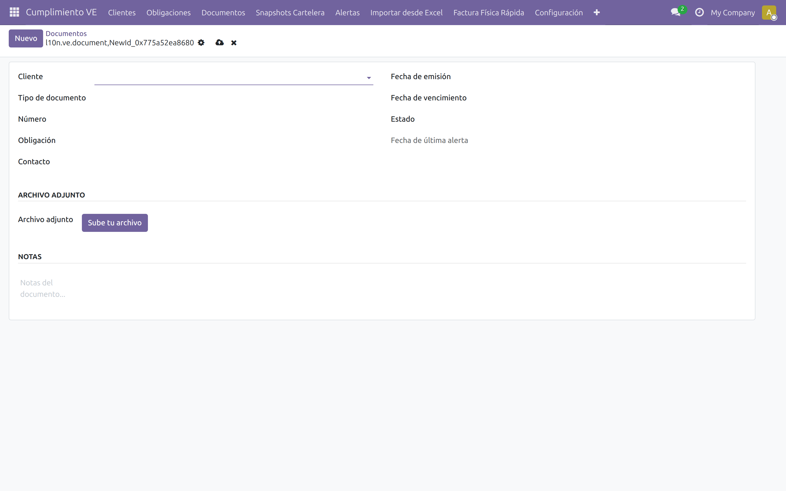
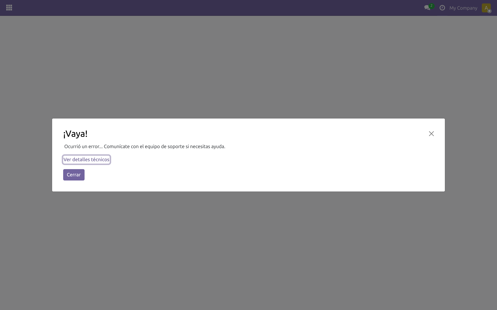

# Cartelera fiscal

## ¿Qué es la cartelera fiscal?

La cartelera fiscal es el conjunto de documentos legales que toda empresa venezolana debe exhibir en un lugar visible del establecimiento. Mantenerla vigente es obligatorio. Renovar cada documento a tiempo evita multas y clausuras.

## Documentos de la cartelera

El módulo incluye 36 tipos de documento organizados por institución:

**Alcaldía (municipal):**
1. Publicación Mercantil
2. Permiso de Bomberos
3. Certificado de Salud
4. Permiso Sanitario
5. Licencia de Actividad Económica
6. Cédula catastral
7. Conformidad de Uso
8. Último Planilla y Recibo de Pago Impuesto Municipal ISAE
9. Último Pago Impuesto de Inmueble
10. Último Planilla y recibo de Pago Aseo
11. Permiso de Publicidad

**SENIAT:**
12. Copia Legal del RIF Actualizado
13. Última declaración y Pago Estimada ISLR
14. Última declaración y Pago ISLR
15. Última declaración, Certificado y Pago IVA
16. Última planilla y Pago impuesto ISLR declarado por anticipado
17. Última planilla y Pago retención de IVA
18. Último certificado Retención de IVA
19. Cert. electrónico Actividad Económica

**IVSS:**
20. Planilla de Inscripción
21. Última factura u Orden de Pago
22. Último soporte de Pago
23. Forma 13-12 Registro Patronal de Asegurados
24. Lista de Trabajadores Activos

**INCES:**
25. Planilla de Inscripción
26. Comprobante de pago trimestral

**FAOV/BANAVIH:**
27. Última Solvencia
28. Comprobante de Afiliación
29. Estado de Cuenta
30. Último soporte de Pago

**MINTRA:**
31. Solvencia
32. Inscripción
33. Planilla NIL
34. Última declaración Trimestral
35. Última Solvencia Laboral
36. Horario de Trabajo MPPPST

## Vista de cartelera por cliente

Ruta: *Cumplimiento VE → Snapshots Cartelera*

El sistema genera snapshots mensuales automáticamente. Cada snapshot muestra:

- **Cliente**
- **Año** y **Mes**
- **Tipo de documento**
- **Estado:** Válido, Expirado, Pendiente, Rechazado o Faltante
- **Fecha de vencimiento**

Filtros disponibles: por cliente, año, mes, tipo de documento y estado.

## Marcar un documento como vigente

Ruta: *Cumplimiento VE → Documentos*

Para marcar un documento como vigente, adjunte evidencia desde el snapshot correspondiente.

## Adjuntar evidencia

Ruta: *[Snapshot Cartelera] → botón [Subir Evidencia]*

El wizard permite subir un archivo (PDF o imagen) como prueba de vigencia. El sistema:

- Valida el tamaño máximo (5 MB)
- Comprime la imagen automáticamente a 1024x1024
- Recalcula el estado del snapshot (si hay una evidencia aceptada, el estado pasa a Válido)

## Alertas de vencimiento

El sistema alerta automáticamente cuando un documento está próximo a vencer. Configure los días de anticipación en cada tipo de documento. Ver [Alertas](./10-alertas.md) para más detalles.

## Reporte por cliente

Ruta: *Cliente → botón [Imprimir Reporte]*

Puede imprimir un reporte con el estado de cartelera del cliente, útil para auditorías.

## Siguiente paso

> Continúa con [Alertas](./10-alertas.md).
