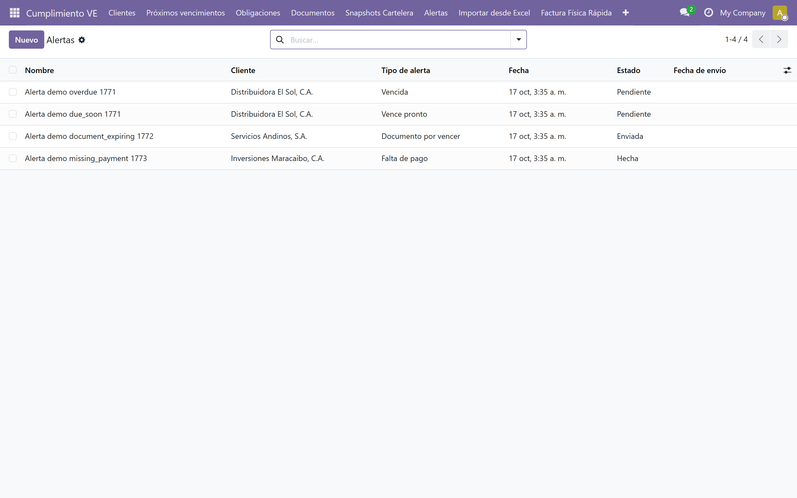

# Alertas

## ¿Para qué sirven las alertas?

El módulo genera alertas cuando un documento de cartelera está próximo a vencer, cuando una obligación está por cumplirse, o cuando hay errores en un import.

## Tipos de alerta

### Alertas por correo electrónico

Se envían automáticamente usando templates de Odoo. Requisito: SMTP configurado (ver [Primeros pasos](./02-primeros-pasos.md), punto 5).

### Alertas por WhatsApp

El módulo genera enlaces `wa.me` con mensaje pre-armado. El contador hace clic y se abre WhatsApp Web/Desktop con el mensaje listo.

WhatsApp no tiene API oficial gratuita. El módulo usa el esquema `wa.me` que requiere acción manual del usuario.

## Ver alertas pendientes

Ruta: *Cumplimiento VE → Alertas*

La lista muestra: **Nombre**, **Cliente**, **Tipo de alerta**, **Fecha**, **Canal**, **Estado** y **Fecha de envío**.

Filtros: Pendientes, Enviadas, Resueltas.

## Configurar destinatarios

Cada alerta tiene destinatarios (partners). El sistema notifica por email o genera enlaces `wa.me` según el canal configurado.

## Marcar una alerta como atendida

Abra la alerta y cambie el estado a **Hecha** usando el statusbar superior.

## Siguiente paso

> Continúa con [Bandeja y análisis](./11-bandeja-acciones-analisis.md).
