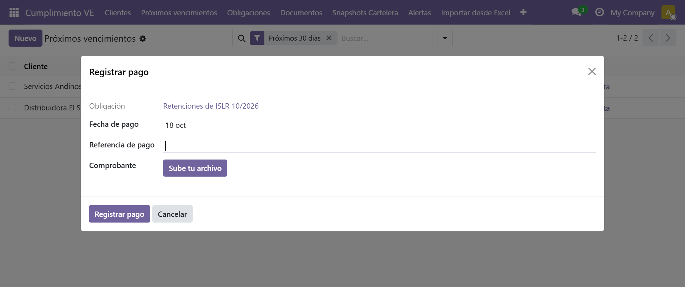
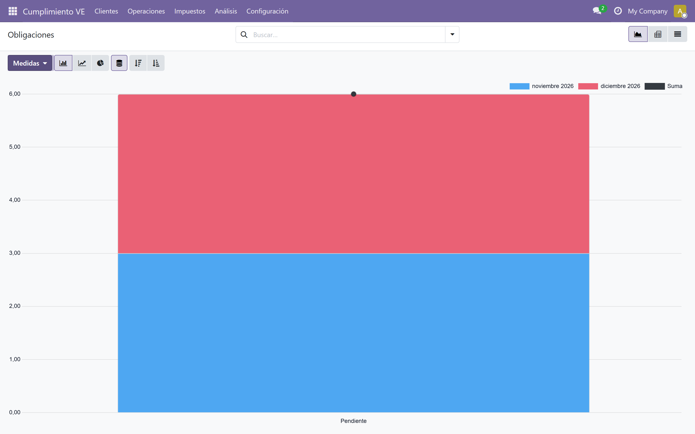
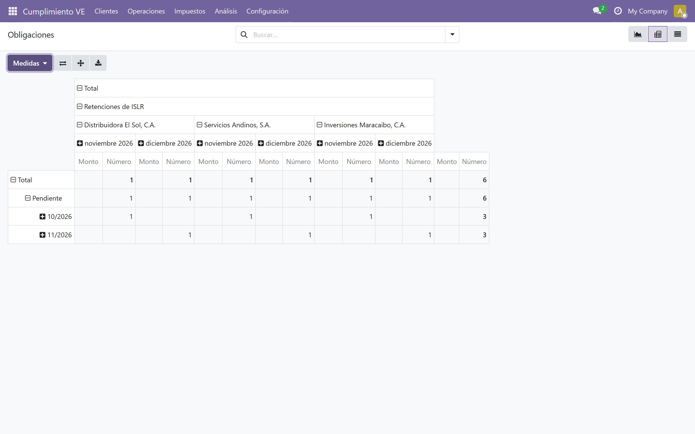

# Bandeja y análisis

## Registrar el pago de una obligación

Ruta: *Cumplimiento VE → Próximos vencimientos* (o *Obligaciones*)

Cada fila de la bandeja incluye los botones **[Registrar pago]** y **[Crear alerta]**, para actuar sin abrir la obligación.

1. Pulse **[Registrar pago]** en la fila de la obligación.
2. Revise la **Fecha de pago** (viene con la fecha de hoy) y complete la **Referencia de pago** y el **Comprobante** si los tiene.
3. Pulse **[Registrar pago]** en el diálogo.

La obligación pasa a **Pagada** con su fecha de pago, y el comprobante queda adjunto en la ficha.

- Solo se puede registrar el pago de obligaciones **pendientes o vencidas**.
- La **Referencia de pago** y el **Comprobante** son opcionales.
- Para deshacer un pago use el botón **[Reabrir]** en el formulario de la obligación: el estado vuelve a *Pendiente* o *Vencida* según la fecha, y el comprobante se conserva.

## Crear una alerta manual

El botón **[Crear alerta]** de cada fila (también en el formulario de la obligación) genera una alerta **manual** al instante, sin esperar a la ejecución diaria de alertas.

- **Destinatarios y canal:** los mismos configurados en el tipo de obligación (contador asignado como destinatario, con copia al cliente si la opción está activa; email o WhatsApp con enlace `wa.me`).
- **Sin duplicados:** si ya existe una alerta manual pendiente o enviada para esa obligación, el sistema avisa y no la repite. Cuando la alerta se marca como *Hecha*, se puede volver a enviar.

Use **[Crear alerta]** para recordarle el pago al cliente antes del vencimiento, y registre el pago con **[Registrar pago]** cuando lo confirme.

## Acciones masivas

Para operar sobre varias obligaciones a la vez:

1. Seleccione las obligaciones con las casillas de la izquierda.
2. Abra el menú **⚙ Acciones** de la barra superior.
3. Elija **Marcar pagadas (hoy)** o **Reabrir seleccionadas**.

El sistema aplica la acción solo a las obligaciones **pendientes o vencidas** y reporta cuántas quedaron fuera (por ejemplo, las que ya estaban pagadas).

## Análisis de obligaciones y alertas

Ruta: *Cumplimiento VE → Análisis*

Dos vistas nativas de Odoo (solo lectura) para revisar la carga de trabajo: un gráfico de barras y una tabla dinámica por cada modelo. Las reglas de visibilidad por contador siguen aplicando: cada usuario ve sus propios clientes.

### Obligaciones

El **gráfico de barras** cruza el **estado** de las obligaciones con el **mes de vencimiento**, con las medidas del menú *Medidas* (**Monto** o **Número**).

La **tabla dinámica** permite reorganizar las agrupaciones (estado, período, tipo, cliente, mes de vencimiento) por filas y columnas, y cambiar la medida con el mismo menú *Medidas*.

### Alertas

Las vistas de **Alertas** muestran el gráfico *estado × tipo* y la tabla dinámica con las agrupaciones *estado*, *canal* y *tipo*, útil para detectar alertas acumuladas sin enviar.

## Siguiente paso

> Continúa con [Exportar y respaldar datos](./12-exportar-respaldos.md).
