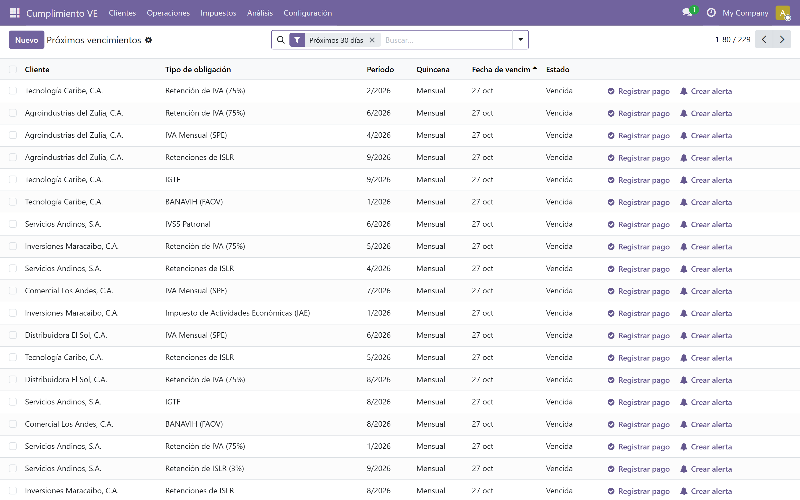
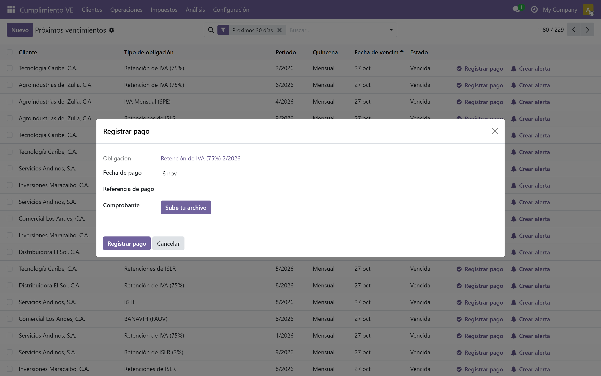
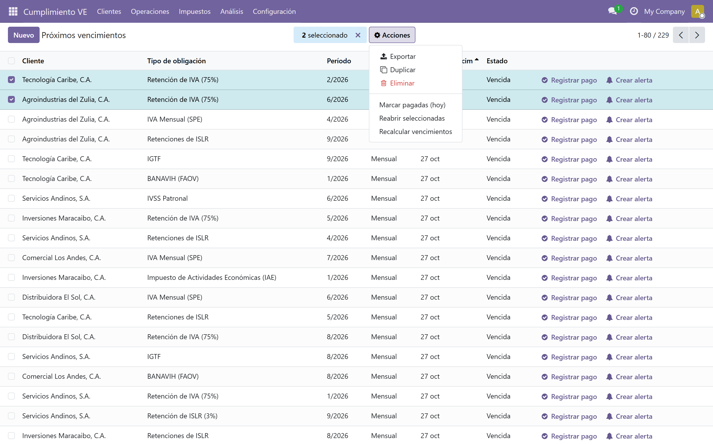
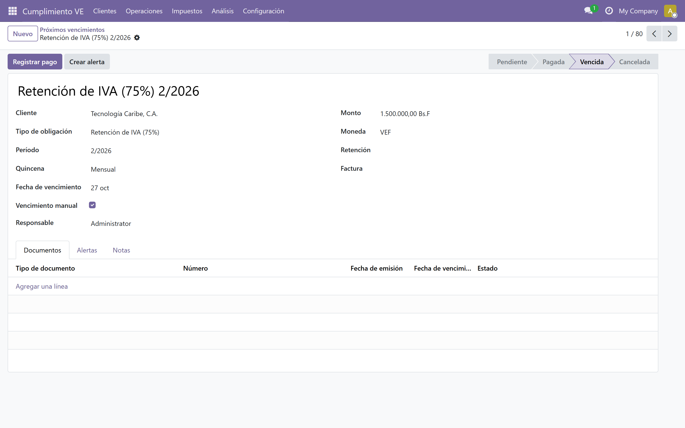
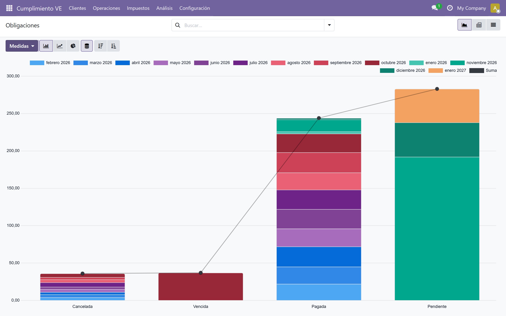
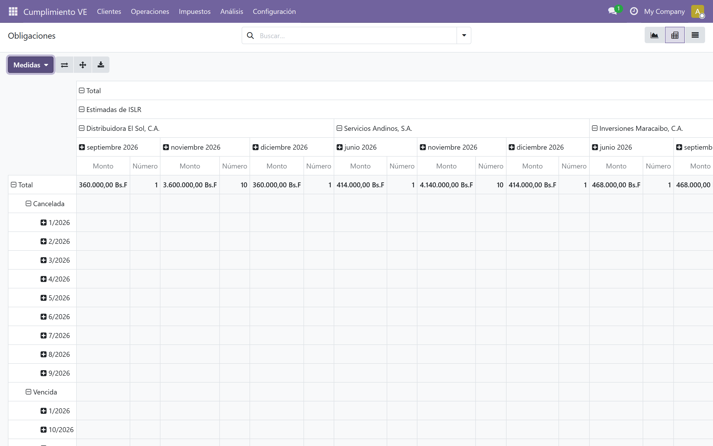

# Bandeja y análisis

## Registrar el pago de una obligación

Ruta: *Cumplimiento VE → Operaciones → Próximos vencimientos* (o *Operaciones → Obligaciones*)

Cada fila de la bandeja incluye los botones **[Registrar pago]** y **[Crear alerta]**, para actuar sin abrir la obligación.

1. Pulse **[Registrar pago]** en la fila de la obligación.
2. Revise la **Fecha de pago** (viene con la fecha de hoy) y complete la **Referencia de pago** y el **Comprobante** si los tiene.
3. Pulse **[Registrar pago]** en el diálogo.

La obligación pasa a **Pagada** con su fecha de pago, y el comprobante queda adjunto en la ficha.

- Solo se puede registrar el pago de obligaciones **pendientes o vencidas**.
- La **Referencia de pago** y el **Comprobante** son opcionales.
- Para deshacer un pago use el botón **[Reabrir]** en el formulario de la obligación: el estado vuelve a *Pendiente* o *Vencida* según la fecha, y el comprobante se conserva.

## Crear una alerta manual

El botón **[Crear alerta]** de cada fila (también en el formulario de la obligación) genera una alerta **manual** al instante, sin esperar a la ejecución diaria de alertas.

- **Destinatarios y canal:** los mismos configurados en el tipo de obligación (contador asignado como destinatario, con copia al cliente si la opción está activa; email o WhatsApp con enlace `wa.me`).
- **Sin duplicados:** si ya existe una alerta manual pendiente o enviada para esa obligación, el sistema avisa y no la repite. Cuando la alerta se marca como *Hecha*, se puede volver a enviar.

Use **[Crear alerta]** para recordarle el pago al cliente antes del vencimiento, y registre el pago con **[Registrar pago]** cuando lo confirme.

## Acciones masivas

Para operar sobre varias obligaciones a la vez:

1. Seleccione las obligaciones con las casillas de la izquierda.
2. Abra el menú **⚙ Acciones** de la barra superior.
3. Elija una acción: **Marcar pagadas (hoy)**, **Reabrir seleccionadas** o **Recalcular vencimientos** (además de *Exportar*, *Duplicar* y *Eliminar*).

El sistema aplica la acción solo a las obligaciones **pendientes o vencidas** y reporta cuántas quedaron fuera (por ejemplo, las que ya estaban pagadas).

## Recalcular vencimientos

La fecha de vencimiento se calcula sola con el **Calendario SENIAT** (sección 08). Si corrige una fecha en las tablas del calendario o carga feriados nuevos, puede recalcular las obligaciones afectadas:

- **Desde el formulario de la obligación:** botón **[Recalcular vencimiento]** en la barra de botones.

  

- **Desde la lista (masivo):** seleccione varias obligaciones → **⚙ Acciones → [Recalcular vencimientos]**. El sistema avisa cuántos vencimientos recalculó y cuántos quedaron fuera.

Dos casos quedan **fuera** del recálculo, a propósito:

- Obligaciones **pagadas**: conservan la fecha con la que se pagaron.
- Obligaciones con **vencimiento manual** (fecha corregida a mano): su fecha siempre gana.

El botón del formulario no aparece en esos dos casos.

## Análisis de obligaciones y alertas

Ruta: *Cumplimiento VE → Análisis*

Dos vistas nativas de Odoo (solo lectura) para revisar la carga de trabajo: un gráfico de barras y una tabla dinámica por cada modelo. Las reglas de visibilidad por contador siguen aplicando: cada usuario ve sus propios clientes.

### Obligaciones

El **gráfico de barras** cruza el **estado** de las obligaciones con el **mes de vencimiento**, con las medidas del menú *Medidas* (**Monto** o **Número**).

La **tabla dinámica** permite reorganizar las agrupaciones (estado, período, tipo, cliente, mes de vencimiento) por filas y columnas, y cambiar la medida con el mismo menú *Medidas*.

### Alertas

Las vistas de **Alertas** muestran el gráfico *estado × tipo* y la tabla dinámica con las agrupaciones *estado*, *canal* y *tipo*, útil para detectar alertas acumuladas sin enviar.

## Asistente Fiscal (Chat IA)

El módulo integra un **asistente conversacional (ContaFis AI)** dentro de *Discuss* (chat de Odoo). Permite hacer consultas en lenguaje natural sobre obligaciones, clientes, alertas, documentos y más.

### Cómo acceder

**Ruta:** *Discuss* (icono de burbuja en la barra superior) → Buscar **"ContaFis AI"** en la lista de contactos → Abrir chat.

### Autenticación por sesión (novedad Spec 005)

El asistente **ya no requiere API key personal**. Usa su **sesión web activa de Odoo** automáticamente:

1. Inicie sesión en Odoo como de costumbre (usuario no-admin, ej. `contador.demo`).
2. Abra el chat *ContaFis AI*.
3. Escriba su consulta; el bot valida su sesión (`X-Odoo-Session`) y responde con sus datos.

> **Ventaja:** No debe generar ni guardar API keys. La sesión expira a las 24 h de inactividad; si ve *"Tu sesión de Odoo expiró"*, recargue Odoo y vuelva a intentarlo.

### Ejemplos de consultas

| Consulta | Qué hace el asistente |
|----------|----------------------|
| *"¿Qué obligaciones vencen esta semana para Servicios Andinos?"* | Busca obligaciones pendientes/vencidas de esa empresa y lista fechas, montos y tipos |
| *"Alertas pendientes de enviar"* | Muestra alertas en estado *Pendiente* o *Enviada* sin marcar *Hecha* |
| *"Documentos por renovar de Inversiones Maracaibo"* | Consulta la cartelera fiscal y filtra por cliente y estado *Por renovar* |
| *"Clientes con obligaciones ISLR atrasadas"* | Cruza obligaciones ISLR vencidas y devuelve lista de clientes |

### Disclaimer legal

> **⚠️ Esta respuesta es generada por un asistente de IA y tiene carácter meramente informativo. No constituye asesoría legal, fiscal ni profesional. Para decisiones importantes, consulte a un profesional calificado.**

Este disclaimer aparece **al final de cada respuesta del bot** en el chat.

### Alcance y limitaciones

- **Solo lectura:** el asistente consulta datos (obligaciones, clientes, alertas, documentos, cartelera); **no crea, edita ni borra** registros.
- **Empresas visibles:** responde solo sobre las empresas que su usuario tiene activas en el selector de la barra superior.
- **Fuentes:** cita la fuente de cada dato (modelo Odoo, campo, fecha de consulta).
- **No sustituye** el juicio profesional contable/fiscal.

### Solución de problemas del chat

| Síntoma | Causa | Solución |
|---------|-------|----------|
| *"No se pudo clasificar la consulta"* | Pregunta ambigua o fuera de alcance | Reformule: sea específico (empresa, tipo de obligación, período) |
| *"Error de comunicación con el agente"* | Asistente fiscal caído | Verifique que `contafis-assistant` corra en `http://host.docker.internal:8000` |
| *"Sesión no detectada"* | Cookie `session_id` perdida | Recargue Odoo (F5) y vuelva a abrir el chat |
| *"Tu sesión de Odoo expiró"* | Inactividad > 24 h | Inicie sesión de nuevo en Odoo |
| *"La API key requiere atestación"* | (Legacy) Usó `X-User-Token` en vez de sesión | No use API key; use su sesión web normal |

## Siguiente paso

> Continúa con [Exportar y respaldar datos](./12-exportar-respaldos.md).
