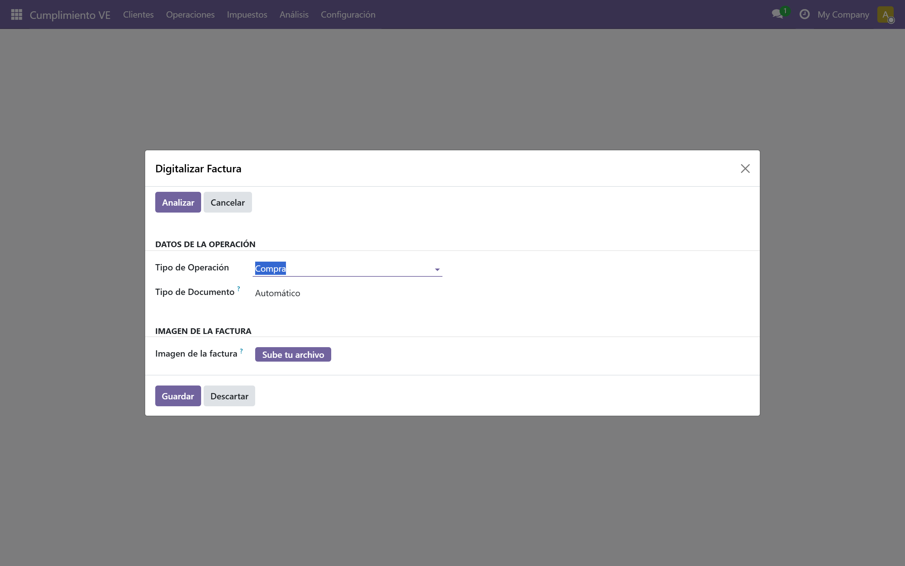

# Digitalización de facturas (IA Vision)

Esta función permite **extraer datos de facturas venezolanas desde una foto o escaneo** usando un modelo de visión (LLM Vision) alojado en NVIDIA NIM. El wizard está integrado en Odoo y envía la imagen al asistente fiscal; la respuesta se muestra estructurada con un **score de confianza** y **advertencias** si detecta problemas (RIF inválido, montos incoherentes, imagen ilegible).

> **Requisitos:** El módulo `l10n_ve_compliance_manager` instalado y el asistente fiscal (`contafis-assistant`) corriendo y accesible desde Odoo (ver configuración en *Ajustes → General → Asistente de IA*).

---

## Acceder al wizard

**Ruta:** *Cumplimiento VE → Impuestos → Digitalizar Factura*

El wizard presenta un formulario simple con tres campos:
- **Imagen:** seleccione un archivo (JPG, PNG o WebP, máx. 5 MB).
- **Tipo de documento:** `Auto` (detección automática), `Factura Z`, `Nota de crédito` o `Nota de débito`.
- **Nombre de archivo:** se autocompleta al seleccionar la imagen.

---

## Formatos soportados

| Formato | Extensiones | Tamaño máximo | Notas |
|---------|-------------|---------------|-------|
| JPEG    | `.jpg`, `.jpeg` | 5 MB | Recomendado para fotos |
| PNG     | `.png` | 5 MB | Bueno para scans |
| WebP    | `.webp` | 5 MB | Compresión moderna |

> **Tip:** Si la imagen es mayor a 5 MB, cómpala antes de subirla (p. ej. con una app de compresión o reduciendo la resolución). El sistema rechazará archivos mayores con error 413.

---

## Colores de confianza

El resultado incluye un **score de confianza (0.0 – 1.0)** que indica qué tan legible fue la imagen para el modelo. El wizard lo muestra con un código de color:

| Color | Rango | Significado | Acción recomendada |
|-------|-------|-------------|---------------------|
| **Verde** | ≥ 0.85 | Muy legible, extracción confiable | Puede usar los datos directamente |
| **Amarillo** | 0.60 – 0.84 | Parcialmente legible | Revise los campos críticos (RIF, montos, número de control) |
| **Rojo** | < 0.60 | Illegible o muy borrosa | **No use los datos**; tome una foto mejor o escanee de nuevo |

---

## Interpretar las advertencias (warnings)

El modelo puede devolver advertencias estructuradas. Cada una tiene un código, mensaje y el campo afectado.

| Código | Qué significa | Qué hacer |
|--------|---------------|-----------|
| `low_confidence` | Imagen borrosa, oscuro, recortada, o texto muy pequeño | Vuelva a fotografiar/escáner con mejor luz y enfoque; asegure que todo el documento quepa en la imagen |
| `invalid_rif` | El RIF extraído no pasa la validación módulo 11 (formato venezolano) | Verifique el RIF en la imagen original; si está correcto, puede ser error de lectura —corríjalo a mano |
| `amount_mismatch` | `subtotal + IVA + IGTF ≠ total` (diferencia > 0.01) | Revise los montos en la imagen; el modelo pudo leer mal un dígito o separador decimal |
| `missing_field` | Un campo obligatorio no se pudo leer (quedó `null`) | Complete el campo manualmente antes de usar los datos |
| `unknown_document_type` | No se pudo detectar si es factura, nota de crédito o débito | Seleccione el tipo manualmente en el wizard (`document_type`) |

> **Importante:** Las advertencias **no impiden** usar el botón "Usar datos en Factura Física Rápida". Sirven para que usted revise y corrija antes de crear el documento.

---

## Usar los datos en "Factura Física Rápida"

Cuando la extracción es satisfactoria (confianza ≥ 0.60 y warnings revisados), el botón **[Usar datos en Factura Física Rápida]** se habilita.

1. Pulse **[Usar datos en Factura Física Rápida]**.
2. Se abre el wizard de *Factura Física Rápida* (sección 04) **pre-rellenado** con:
   - Proveedor (crea o busca por RIF)
   - Fecha, número y control de factura
   - Líneas con descripción, cantidad, precio unitario
   - Bases imponibles (IVA 16 %, IGTF 3 % si aplica)
   - Moneda (USD / VES)
3. Revise y complete cualquier campo faltante (p. ej. centro de costo, analíticas).
4. Pulse **[Crear factura]** para generar la factura de proveedor en estado *Borrador*.

> **Nota:** El botón solo aparece cuando `confidence ≥ 0.60`. Si la confianza es menor, el wizard muestra el mensaje: *"Confianza insuficiente para uso automático. Revise los datos o vuelva a capturar la imagen."*

---

## Disclaimer legal

> **⚠️ Esta digitalización es generada por un asistente de IA y tiene carácter meramente informativo. No constituye un documento certificado por SENIAT ni reemplaza la verificación manual. El usuario es responsable de validar los datos antes de usarlos en declaraciones fiscales o contables.**

Este disclaimer se muestra **en el resultado del wizard** y también en el chat del asistente fiscal (Discuss) cuando consulta sobre facturas digitalizadas.

---

## Flujo completo de ejemplo

1. Recibe una factura impresa de un proveedor.
2. Abre *Cumplimiento VE → Impuestos → Digitalizar Factura*.
3. Sube una foto clara de la factura (tipo `Auto`).
4. Pulsa **[Digitalizar]**.
5. El wizard muestra:
   - **Confianza: 0.92** (verde)
   - Proveedor: *Distribuidora El Sol C.A.*
   - RIF: *J-12345678-9* ✅
   - Nº factura: *001-001-00001234*, Control: *ABC1234567890*
   - Subtotal: 100,00 | IVA 16%: 16,00 | IGTF 3%: 3,00 | **Total: 119,00**
   - Sin warnings
6. Pulsa **[Usar datos en Factura Física Rápida]**.
7. Revisa la factura pre-rellenada, agrega centro de costo y **[Crear factura]**.
8. La factura queda en *Borrador* lista para validar y postear.

---

## Solución de problemas frecuentes

| Síntoma | Causa probable | Solución |
|---------|----------------|----------|
| Error "Imagen excede tamaño máximo" | Archivo > 5 MB | Comprima la imagen o reduzca resolución |
| Error "Extensión no soportada" | Subió `.pdf`, `.tiff`, `.heic` | Convierta a JPG/PNG/WebP |
| Confianza siempre < 0.5 | Foto borrosa, mala luz, documento recortado | Use luz natural, enfoque, encuadre completo, fondo liso |
| RIF sale inválido pero en la factura está bien | Modelo leyó mal un dígito (p. ej. 8 vs 3) | Corrija el RIF a mano antes de usar los datos |
| Montos no cuadran | Separador decimal (coma vs punto) o dígito mal leído | Verifique subtotal, IVA, IGTF y total en la imagen original |
| Botón "Usar datos" no aparece | Confianza < 0.60 | Mejore la calidad de la imagen y vuelva a digitalizar |
| Error 503 "Servicio no disponible" | Asistente fiscal caído o NIM timeout | Verifique que `contafis-assistant` esté corriendo; reintente en 1-2 min |

---

## Siguiente paso

> Continúa con [Asistente Fiscal (Chat IA)](./11-bandeja-acciones-analisis.md#asistente-fiscal-chat-ia) para consultas en lenguaje natural sobre obligaciones, clientes, alertas y más.
